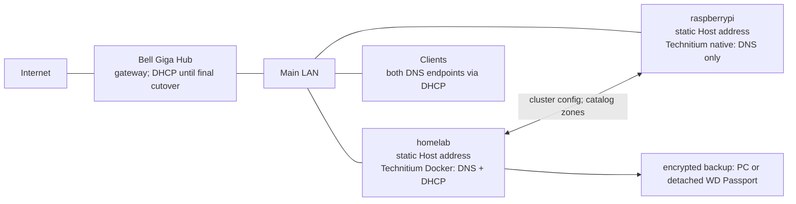

# Home Site DNS and DHCP implementation plan

Status: proposed for review, revised 2026-10-20. This document plans work; it does not deploy software or change the network. It uses the [Technitium research note](../research/technitium-network.md) and [ADRs 0004–0008](../adr/) as its evidence and decision record. Exact Site addresses and MACs belong in SOPS-encrypted inventory, so this plaintext plan uses semantic names.

## Goal and known state

The Bell Giga Hub remains the internet gateway on its existing LAN subnet. The operator has verified that Bell cannot use the previously proposed subnet, but its DHCP service can be disabled. Bell currently serves DHCP. This plan retains the existing subnet and gateway; it changes DHCP ownership only after DNS is working. `homelab` is an Ubuntu Host with Docker and Netplan; `raspberrypi` is a Pi 3 Model B intended for a native Technitium installation. The repo already uses `.home` names in Traefik, but contains no Technitium deployment or Raspberry Pi Host declaration. Existing Netplan, live routes, IPv6 advertisements, port listeners, router DHCP pool, device MACs, and Pi performance have **not** been inspected.

| Status | Architecture statement |
| --- | --- |
| Confirmed by operator | Bell is limited to its existing LAN subnet and can disable its DHCP service. Its LAN address and subnet stay in place during cutover. |
| Confirmed by Technitium | DNS nodes resolve independently; cluster config sync excludes DHCP scopes and leases. Selected zones replicate through the cluster catalog. A secondary zone ceases to serve after its SOA expiry without refresh. [Research](../research/technitium-network.md) |
| Agreed design | Two Host-assigned Stack Instances form one Site-level DNS Cluster. Docker runs on `homelab`; native Technitium runs on `raspberrypi`. Only `homelab` serves DHCP. |
| Agreed design | Use `.home` and a distinct `cluster.home` zone, native recursion on both Hosts, identical cluster-managed filtering, and two DHCP-advertised resolvers. |
| Unverified gate | Pi 3 capacity, Docker host-network port availability, IPv6 DNS behavior, scope exclusion plus reservation behavior, tool compatibility, and restore behavior require a disposable pilot. |



Clients may query either resolver at any time; the labels primary and secondary describe Technitium cluster and zone roles, not client query order. Pi failure leaves `homelab` DNS and DHCP running. Homelab failure leaves Pi DNS working for the agreed 72-hour target, provided the secondary `home` zone has not expired; DHCP allocation and renewal then remain unavailable until homelab or a separate manual recovery procedure returns. New DHCP failover is outside the initial scope.

## Addressing, names, and DNS

The encrypted Site topology contains the retained Bell subnet and gateway, two proposed statically configured Host addresses, reserved device band, dynamic lease band, and MAC-based reservations. The agreed address roles keep their proposed final octets within Bell's existing subnet, subject to a live conflict check. Bell DHCP stays active while the Hosts and DNS are prepared. Before assigning the Hosts' static addresses, verify that Bell's current DHCP pool cannot allocate them; adjust Bell reservations or pool if needed. The Netplan plan must preserve the existing Wi-Fi and default-route behavior and have a timed rollback and local console path. Raspberry Pi OS Lite 32-bit is the initial recommendation for the Pi 3; Raspberry Pi OS uses NetworkManager for static addressing on current releases. [Raspberry Pi OS images](https://www.raspberrypi.com/software/operating-systems/) · [Network configuration](https://www.raspberrypi.com/documentation/configuration/computers/raspberry-pi.html)

On `homelab`, host-networked Docker is required for Technitium DHCP; published Compose ports are removed. Preflight host UDP/TCP 53, UDP 67, the Technitium management HTTPS port, `systemd-resolved`, and other containers. Pin the image by version and digest, persist its configuration, avoid Docker socket access, and restrict management to trusted LAN/VPN clients. The Pi runs a pinned native release under systemd. Both Hosts need independent native recursive resolution, DNSSEC validation, a LAN/VPN recursion ACL, and no resolver dependency on the other Host. If native recursion fails the pilot, evaluate explicit upstream forwarders on each Host; do not add Unbound by default. [Official Compose example](https://github.com/TechnitiumSoftware/DnsServer/blob/v15.6.1/docker-compose.yml) · [Technitium capabilities](https://technitium.com/dns/)

The primary `home` zone and the Site reverse zone reside on `homelab` and join the cluster catalog; the Pi receives secondary copies. `cluster.home` is reserved for Technitium-managed node records. Statically addressed Hosts get declared A/PTR records; service names such as `jellyfin.home` and `sonarr.home` remain aliases to their destination Host. DHCP may publish temporary A/PTR records from named leases and stable records from named reservations. Client-supplied names cannot overwrite declared records. Test record creation, change, expiry, collision handling, and transfer to Pi before enabling DHCP. Protect Host A/AAAA, NS/SOA, cluster, and reverse-zone changes behind the manual gate. [Research](../research/technitium-network.md)

Set the `home` SOA expiry beyond 72 hours with a margin, monitor last successful transfer and zone age, and rehearse promotion before the margin is exhausted. The Pi must answer local and external test queries while `homelab` is stopped. DNS caches and logs remain independent. Filtering lists and policy synchronize through the cluster, but a failed list download must be observed and the last known policy verified in the pilot. [Technitium clustering guide](https://blog.technitium.com/2025/11/understanding-clustering-and-how-to.html)

The DHCP scope must advertise the gateway, both DNS addresses, `home` as domain/search suffix where client support allows, and a lease time chosen after migration testing. Technitium appears to require reservations inside the scope's start/end interval. To preserve the agreed low-address reservations and high-address dynamic band, make the scope span both bands and exclude the reserved band from dynamic allocation. Verify this combination on the pinned release with a real reserved test client; retain Bell DHCP if it fails. `useThisDnsServer` must be false when the explicit two-address DNS option is set. Keep all statically configured infrastructure addresses outside the scope. [Technitium DHCP API](https://github.com/TechnitiumSoftware/DnsServer/blob/v15.6.1/APIDOCS.md#dhcp-api-calls) · [Research](../research/technitium-network.md)

`.home` is deliberate, despite RFC 8375 designating `.home.arpa` and documenting collision/leak risks. DNS names may fail on devices that bypass the advertised resolvers; ordinary DHCP advertising does not force clients or browsers using DoH to use Technitium. Initial filtering coverage is best effort on the main LAN. Guest Wi-Fi, Bell TV, other segments, and remote Tailscale failover are outside the first cutover until their routing and DNS paths are inventoried. [ADR-0005](../adr/0005-use-home-for-local-dns.md) · [RFC 8375](https://www.rfc-editor.org/rfc/rfc8375.html)

## Technology choices

| Choice | Rationale and limit |
| --- | --- |
| Technitium on both Hosts | Supplies integrated authoritative/recursive DNS, DHCP on one Host, filtering, API, and cluster configuration sync. DHCP scopes and leases remain single-Host. [Technitium](https://technitium.com/dns/) |
| Docker primary; native Pi secondary | Matches the operator's Host preferences. Docker DHCP requires host networking, so port conflicts are a release gate; native installation avoids a container runtime on the 1 GB Pi. [Official Compose example](https://github.com/TechnitiumSoftware/DnsServer/blob/v15.6.1/docker-compose.yml) |
| Raspberry Pi OS Lite 32-bit | Lightweight supported image for the Pi 3; use the release's NetworkManager profile for static addressing. A failing performance pilot calls for a stronger secondary Host, not for dropping independent DNS. [Raspberry Pi OS](https://www.raspberrypi.com/software/operating-systems/) |
| Ansible-first API pilot | Reuses existing declarative modules and YAML, conditional on verified v15 compatibility. Python remains a narrow fallback for uncovered API behavior. Terraform adds state and another configuration language. [Research](../research/technitium-network.md) |
| SOPS/age, systemd polling, internal CA | Keeps topology/credentials encrypted, avoids inbound deployment endpoints, and provides trusted private HTTPS. The CA root is kept offline; the timer handles only the approved automatic class of changes. [ADRs 0006–0008](../adr/) |

## Git ownership and deployment

Keep the existing repository-wide `homelab site validate/plan` interface read-only, as required by [ADR-0004](../adr/0004-site-inventory-and-host-assigned-stack-instances.md). Add two Host-assigned network Stack Instances to the Site Inventory and declare their DNS Cluster relationship at Site level. The network Stack owns its own mutation command, rather than extending the Media Stack's Go reconciler. The following is a **proposed** layout, not files or commands already present:

```text
sites/home/
  site.yaml                         # Host/Stack Instance references and cluster relationship
  network.yaml                      # readable semantic network policy and DNS aliases
  secrets/network-topology.sops.yaml # encrypted subnet, Host/device IPs and MACs
services/network/
  compose.yaml                      # pinned primary container, host network
  ansible/                          # pinned collection and candidate playbooks
  schema/                           # Site network validation contract
  secrets/technitium.sops.yaml      # automation and backup credentials; leaf keys if needed
  systemd/                          # proposed polling service/timer units
  README.md                         # entry point for the step-by-step setup guide
  docs/setup.md                     # ordered setup and cutover walkthrough
  docs/backup-restore.md            # backup, verification, and recovery walkthrough
docs/plans/home-network.md
docs/research/technitium-network.md
```

The readable policy refers to semantic IDs; a single decrypted Site topology supplies address and MAC values. Do not duplicate operational addresses in Traefik files, plaintext docs, or general logs. Protect any local plan that displays decrypted values with restrictive permissions and redact them from shared logs. An illustrative schema without real topology values:

```yaml
apiVersion: homelab.network/v1alpha1
kind: SiteNetwork
metadata:
  site: home
spec:
  topologyRef: home-lan
  domain: home
  clusterDomain: cluster.home
  resolvers: [homelab, raspberrypi]
  dhcp:
    owner: homelab
    scopeRef: home-lan
    dnsUpdates: true
    reservations:
      - device: reolink-nvr
        addressRef: devices.reolink-nvr.ipv4
        macRef: devices.reolink-nvr.mac
  records:
    - name: jellyfin.home
      type: CNAME
      target: homelab.home
```

The schema must reject duplicate addresses, MACs, or names; addresses outside the Site subnet; reserved/dynamic overlap except the deliberately excluded reservation band; gateway/Host addresses inside the DHCP allocation band; missing Host references; invalid record targets; unsupported options; and undecryptable values. Git owns scopes, reservations, fixed DNS records, filtering policy, and relevant settings. Active leases, temporary lease-derived A/PTR records, caches, and logs are observed runtime state, not declarations. Unknown live records are reported, not deleted automatically. SOPS may encrypt individual YAML values for structural readability or an entire private file; use multiple authorized age recipients without committing any private identity. [ADR-0006](../adr/0006-encrypt-home-network-address-inventory.md)

Before writing a custom Python reconciler, pilot the [effectivelywild Ansible collection](https://github.com/effectivelywild/ansible-collection-technitium-dns) against a pinned disposable Technitium release. Its published collection predates v15, so require proof of bearer authentication, read/diff, check mode, unchanged second apply, updates, reservation handling, deletion, cluster operations, and backup/restore. Pin the collection. Terraform adds state and HCL; the existing Python client provides API calls but not a complete reconciler. If the Ansible pilot fails, use the supported API through a small Python adapter for only the missing resources, with explicit read/diff/apply/verify behavior. [Tool comparison](../research/technitium-network.md)

A systemd timer on `homelab` polls the remote main branch, fetches one immutable commit, decrypts with a dedicated age identity, validates schema, reads Technitium state, and writes a redacted change plan. A file lock prevents concurrent runs. If a commit contains any protected change, apply **none** of that commit automatically; an operator applies the exact plan through a proposed network Stack command. The command re-reads live state and rejects a changed commit or stale plan. Routine service alias adds/updates may apply automatically, followed by verification. Drift and failures leave the last known-good state active and appear in journald; no forced service restart for a no-op. Git webhooks and a Docker-capable self-hosted runner are unnecessary. [ADR-0007](../adr/0007-gate-high-impact-network-changes.md)

The automation identity gets only the Technitium permissions proven necessary by the pilot. Backup/restore uses a separate tightly held credential because the vendor backup API requires broad `Settings: Delete` permission. Store API tokens and leaf private keys only as SOPS ciphertext; keep age private identities outside Git and use separate recipients for network secrets. The internal CA root private key stays offline with an encrypted backup. Issue trusted HTTPS certificates for both Technitium management endpoints before joining the cluster; distribute the CA trust only to administrator devices initially. Do not terminate node-to-node cluster TLS at Traefik. Traefik HTTPS for general `.home` services is a later phase. [ADR-0008](../adr/0008-keep-home-ca-root-offline.md) · [Technitium cluster TLS](https://blog.technitium.com/2025/11/understanding-clustering-and-how-to.html)

## Backup, rollback, and health

Make encrypted Technitium backups before protected applies, after successful cutover, and on a schedule. Include settings, zones, scopes, reservations, and lease state, plus a manifest with commit, Technitium version, Host, time, and checksum. Copy at least one recoverable archive off `homelab`; use `pc` when its OS and uptime support reliable transfers, and use the WD Passport as a detached second copy. If `pc` is unsuitable, a verified Passport backup can satisfy the recovery gate only after the drive is detached and stored separately; an always-attached USB disk alone does not. Back up the offline CA root separately. Test restore on an isolated instance with DHCP disabled, since the restore API can restart DHCP and a simultaneous live responder would be unsafe. The API may archive only the most recently flushed scope file, so a few seconds of lease history may be absent; Git remains authoritative for reservations. [Technitium backup API](https://github.com/TechnitiumSoftware/DnsServer/blob/v15.6.1/APIDOCS.md) · [Research](../research/technitium-network.md)

Provide one proposed `network-stack` operator command with `backup`, `backups`, `verify-backup`, and `restore` subcommands. `backup` requests a full API archive from **each** Technitium node, explicitly including node and cluster configuration, DNS settings, zones, DHCP scopes, apps, and authentication settings where applicable; it also captures the active Git commit and deployment manifest. Encrypt each archive for the designated recovery age recipients before copying it to the selected destination, then verify the copy and record checksums. A systemd timer may run this command on a schedule, with a separate pre-change backup; failure must alert and block protected applies. Keep the broader backup API credential separate from routine deployment credentials.

`backups` lists available archives, their node, version, time, commit, destination, and verification status. `verify-backup` checks decryption, ZIP integrity, manifest/checksums, and required archive members without applying anything. `restore --dry-run` checks archive compatibility, target node, selected restore categories, current DNS/DHCP ownership, and the recovery path. The normal restore target is an isolated Technitium instance with DHCP disabled; after its DNS and scope data pass inspection, a live restore is a supervised, exact-archive operation with a fresh pre-restore backup and a selected-node health check. A live restore must never enable a second DHCP responder or restore both DNS nodes together. Store private age identities, CA root material, external certificate keys, and Host recovery profiles outside the API archive according to their separate custody procedures. [Technitium backup and restore API](https://github.com/TechnitiumSoftware/DnsServer/blob/v15.6.1/APIDOCS.md#backup-settings)

Minimum health checks: query each resolver explicitly for a declared Host name, a service alias, a reverse PTR, and an uncached external domain; verify recursion and expected filtering independently; inspect zone serial/age, cluster synchronization, process/container health, and memory on the Pi. From an isolated DHCP test client, inspect the lease's subnet, gateway, both DNS addresses, domain/search suffix, and reservation behavior; confirm exactly one DHCP offer source. Monitor the last successful Git deployment, protected plan awaiting approval, drift, latest backup/restore drill, and alert when zone age approaches the 72-hour margin. Use Docker logs for the primary and journald for the Pi and timer. A future status command should show the active Git commit and redacted drift without exposing decrypted topology.

Proposed read-only operator workflow: `network-stack status` reports active commit, DNS/DHCP health, backup age, and pending protected plan; `network-stack plan` reports redacted drift; `network-stack health` queries both configured resolver endpoints; `journalctl -u network-stack-deploy.service` shows timer failures. `network-stack apply --plan <plan-id>` is a **future** protected command that must verify the plan digest and current state. None of these network Stack commands or units exists yet. Existing `git rev-parse HEAD` shows only the local checkout commit, not proof that it is the active deployment.

Security risks and controls:

| Risk | Control |
| --- | --- |
| Open resolver or public management UI | Bind and firewall DNS recursion to authorized LAN/VPN sources; restrict HTTPS management separately; never forward either service from Bell's WAN. Verify both IPv4 and IPv6 paths. |
| Host-networked Docker exposes unexpected listeners | Inventory ports first; remove Compose `ports`, bind only needed Technitium endpoints, use a pinned image and persistent restricted config, and grant no Docker socket. |
| Automation token or age identity leak | Dedicated narrow API token, separate broad backup identity, separate network age recipients, encrypted transport and local files, secret-free logs, and rotation runbook. |
| CA compromise or certificate expiry | Offline root and encrypted backup; supervised issuance, admin-device trust distribution, expiry monitoring, and tested renewal. |
| DHCP competition or bad scope | Disabled scope before cutover, isolated reserved/dynamic tests, Bell off before Technitium on, and a reversible single-responder runbook. |
| Partial API apply or drift | Snapshot, ordered per-resource apply, readback verification, exact plan hashes, explicit deletion gate, and manual recovery when a multi-resource operation partially succeeds. |
| DNS filtering bypass | Advertise both DNS endpoints, inspect IPv6 DNS advertisements, measure clients using other resolvers or DoH, and avoid claiming enforcement without gateway control. |

Rollback is phase-specific: restore the previous Host network profiles if static addressing fails; stop Technitium DHCP before re-enabling Bell DHCP for DHCP cutover; restore a previous pinned Technitium version and known-good config for a failed upgrade; reverse a routine record change from an exact prior plan. A full settings restore is a maintenance operation, not an automatic response to every API error. Preserve the previous working DNS resolver during each step and never restart both DNS Hosts together. Bell's LAN subnet and gateway stay unchanged throughout.

## Required step-by-step documentation

Before any live network change, write and review `services/network/docs/setup.md` as an operator walkthrough in the same order as the phases below. The entry-point README must link to it. Each step must say which machine or Bell admin page to use, prerequisites and required access, the exact command or UI action, expected result, how to verify it, when to stop, and how to undo that step. Include the read-only inventory, encrypted inventory and age key setup, Pi OS installation, static Host addressing, Technitium installation on each Host, internal CA and management HTTPS, DNS and cluster configuration, DHCP cutover, systemd polling, and post-cutover checks. Mark actions that can interrupt household access and identify the wired/local-console recovery route. Use placeholders or secret-safe commands rather than publishing real IPs, MACs, tokens, or decrypted output.

Write `services/network/docs/backup-restore.md` with worked examples of `backup`, `backups`, `verify-backup`, isolated `restore --dry-run` and restore, plus PC and detached WD Passport handling. It must show how to locate the correct archive and recovery age identity when `homelab` is unavailable, how to keep an isolated restore from answering household DHCP, and how to verify DNS and DHCP after a supervised live recovery. Keep the documentation and command behavior synchronized; a phase is incomplete until a second operator can follow its steps and its rollback using the documented prerequisites.

## Implementation phases and release gates

Every path below is a **proposed future file** unless it already exists. A phase may proceed only after its verification and recovery path work; no phase in this document authorizes installation or a live network change.

### 0. Inventory and feasibility

- **Objective/prerequisites:** Capture Bell LAN/DHCP/IPv6 settings; Ubuntu Netplan and Wi-Fi, routes, firewall, Tailscale, listeners and Docker bindings; existing leases and MACs; NVR/camera management and port forwards; PC backup capability. Read-only access to each device is sufficient.
- **Files/tools/configuration:** Add an encrypted topology inventory and a redacted inventory report only during implementation. Record the existing Bell settings and Host profiles in a recovery packet. Change nothing.
- **Verify/rollback:** Confirm all proposed addresses are free, Bell DHCP can avoid the future static Host addresses, no other DHCP server answers, and a wired local recovery client works. No rollback is needed for read-only work. Block the plan if IPv6 advertises an unapproved DNS path that cannot be corrected.

### 1. Disposable compatibility pilot

- **Objective/prerequisites:** Select and pin a Technitium release and candidate Ansible collection; use an isolated test LAN or disposable VMs, with no path to answer production DHCP broadcasts.
- **Files/tools/configuration:** Proposed `services/network/ansible/`, schema fixtures, and pilot procedure; no household configuration changes.
- **Verify/rollback:** Prove host-networked DHCP, the excluded reservation band, exact DHCP options, A/PTR lifecycle, zone transfer, independent recursion, filtering, Ansible dry-run/idempotency and rollback, and backup restore. Exercise cluster failure and SOA expiry on shortened test timers as well as a normal soak. Destroy only disposable resources to roll back. If a library lacks safe behavior, narrow custom Python to that gap or change the design before proceeding.

### 2. Trust, backup, and Host preparation

- **Objective/prerequisites:** Have physical access, encrypted off-Host or detached backup storage, age recipients, and internal CA custody established.
- **Files/tools/configuration:** Proposed topology and Technitium SOPS documents, CA issuance and trust instructions, pinned image/native package manifest, network Stack backup/restore and status procedures. Add `raspberrypi` to the Site Inventory.
- **Verify/rollback:** Decrypt only with authorized identities, validate permissions and certificate chains, verify checksum and isolated restore, and confirm Host rollback profiles. Remove only newly staged assets if preparation fails; Bell remains unchanged.

### 3. Static Host addresses and DNS-only staging on the current LAN

- **Objective/prerequisites:** Finish the pilot and port inventory. Confirm the proposed Host addresses are free and excluded from Bell's allocation pool. Keep Bell DHCP authoritative.
- **Files/tools/configuration:** Version proposed Netplan and Pi NetworkManager profiles as protected Site changes; keep actual addresses in SOPS. Prepare timed reversion and a local console recovery path. Stage the Docker Compose service on `homelab`, native Pi service, minimal local `home` records, and health-check procedure.
- **Verify/rollback:** Set each Host's static address on the existing LAN and check gateway, WAN, SSH, Docker services, Traefik, Minecraft forwarding, cameras, NVR, and Tailscale as relevant. A manually configured test client can query each resolver for local and external names without changing household DHCP options. Check Pi CPU/memory and power/storage behavior. Revert the Host profiles locally if addressing fails; stop the new DNS services and return the test client to Bell DNS if needed.

### 4. Final DNS cluster and zone replication

- **Objective/prerequisites:** Static Host addresses and internal CA certificates work; Bell still serves DHCP.
- **Files/tools/configuration:** Establish `cluster.home`, the primary `home` and reverse zones, catalog membership, filtering, ACLs, and node-specific endpoints. The Pi remains DHCP-disabled.
- **Verify/rollback:** Both resolvers answer independently, match local zone data and filtering, and survive either DNS process stopping. Verify zone age and a rehearsed manual Pi promotion; check the agreed 72-hour service margin. Revert only the failed DNS/cluster change from backup, leaving Bell DHCP in place.

### 5. Declare and cut over DHCP

- **Objective/prerequisites:** Scope/exclusion pilot passed, DNS and backup restore passed, and the main LAN plus IPv6 audit passed. Maintain local access and a Bell DHCP rollback record.
- **Files/tools/configuration:** Apply the protected scope, exclusions, options, and reservations with allocation disabled; verify via API. At cutover disable Bell DHCP, then enable Technitium DHCP. Do not run overlapping live pools.
- **Verify/rollback:** A test client obtains the intended dynamic or reserved address, gateway, two resolvers, and `home` suffix from exactly one server; A/PTR records appear on both DNS Hosts. Renew representative clients and check services, cameras, and NVR. If failed, disable Technitium DHCP first, re-enable Bell DHCP, renew test clients, and investigate before retrying.

### 6. Polling deployment and routine operation

- **Objective/prerequisites:** The network has stabilized and the manual plan/apply path plus backup/restore have been exercised.
- **Files/tools/configuration:** Install a least-privilege systemd service/timer on `homelab`, pinned Git fetch credentials, file locking, journald logs, health/status commands, and alerting for drift, backup age, cluster sync, and DNS checks. Existing [DuckDNS timer guidance](../../services/duckdns/README.md) is a reusable pattern, not an installer for this Stack.
- **Verify/rollback:** A no-change commit produces an empty plan; a routine alias update applies once; a protected change stops at a plan; a stale approval is rejected; a bad commit leaves the known-good state serving. Disable the timer and run the previous pinned version manually if automation fails.

### 7. Recovery drills and optional expansion

- **Objective/prerequisites:** DHCP is stable and backup copies are available away from the active Host.
- **Files/tools/configuration:** Record restore-drill outcomes, certificate rotation, upgrade order, and failure runbooks. Plan trusted Traefik HTTPS and remote Tailscale DNS failover separately.
- **Verify/rollback:** Restore to an isolated instance with DHCP off; simulate each Host outage and internet/Git loss; confirm zone expiry alerts and promotion timing; verify certificates and backup decryptability. Restore the last known-good deployment if a drill uncovers drift; never let an isolated restore answer household DHCP.

## Failure expectations

| Failure | Expected behavior and operator response |
| --- | --- |
| Homelab Technitium stops or Host loses power | Pi continues external recursion and local `home` authority until SOA expiry; DHCP cannot issue or renew leases. Alert, restore homelab, or manually promote Pi for prolonged DNS outage. Existing client leases may continue until their own expiry. |
| Pi Technitium or Pi power fails | Homelab continues DNS and DHCP. Repair Pi, rejoin/resync, verify zone serial and independent recursion before considering DNS redundancy restored. |
| Internet unavailable | Local authoritative names and DHCP remain; uncached external names may fail under native recursion. Do not change resolver policy automatically. |
| Git remote unavailable | Last applied configuration continues; timer reports fetch failure and retries later without restarting DNS or DHCP. |
| Invalid or undecryptable commit | Validation fails before mutation; prior state stays active and an actionable, secret-free error is logged. |
| Technitium API unavailable | No reconciliation occurs; DNS/DHCP service health is checked separately and the pending plan is retried only after API recovery. |
| Cluster synchronization fails | Both DNS services can continue with their last local state, but records/filtering may diverge. Alert on zone serial, age, and config sync; pause protected applies until corrected. |
| DHCP unavailable | Existing leases last until their expiry; new/renewing clients may lose network access. Restore the primary or execute the supervised Bell DHCP rollback. |
| Primary down near secondary SOA expiry | Pi local zone will cease serving on expiry even if external recursion works. Restore primary or manually promote Pi before the deadline; verify answers afterward. |
| Bad configuration or upgrade | Stop further applies, inspect the exact commit/plan, restore the pinned release and known-good config as needed, and verify each DNS Host separately. |

## Open evidence and simpler boundaries

Before implementation, obtain the live Netplan and router state, IPv6 RA/RDNSS behavior, Bell DHCP pool controls, all hard-coded service addresses, Tailscale topology, PC backup OS/uptime, and device MAC inventory. The disposable pilot must settle Pi capacity, Ansible v15 compatibility, scope exclusion with reservations, DHCP-derived record replication, zone expiry, backup lease fidelity, and cluster/firewall ports. The Site cannot claim universal DNS filtering while clients may use DoH or other resolvers; measuring exceptions is part of operations.

Keep one DHCP owner, two independent DNS resolvers, one Site topology inventory, one systemd polling loop, and one internal CA. Avoid a shared database, Unbound, a public webhook, a Docker-capable GitHub runner, automatic destructive pruning, and Traefik HTTPS during the first cutover. These boundaries can be revisited after the DNS and DHCP recovery drills pass.
