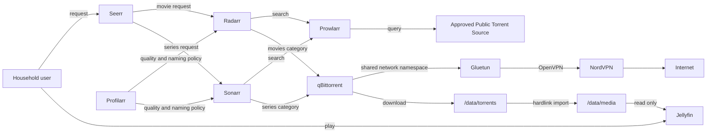
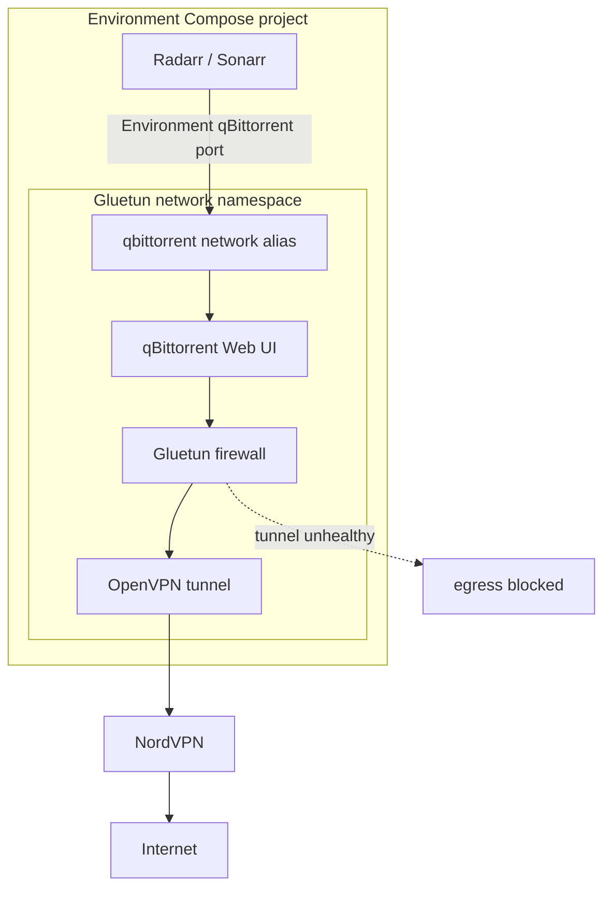
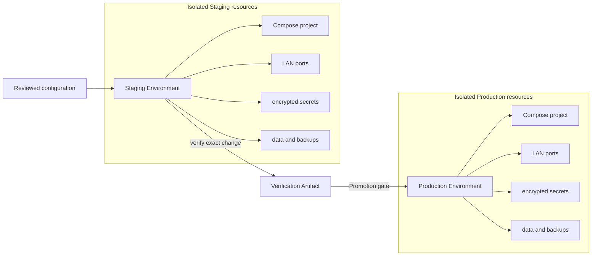
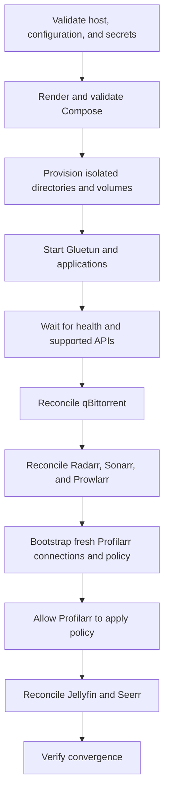

# Home Media Stack

The Home Media Stack is a reproducible, self-hosted system for requesting, acquiring, organizing, and playing movies and
episodic television. It is designed for Ubuntu and Docker Desktop with WSL 2, confines torrent traffic to NordVPN, and keeps
independent Production and Staging Environments so changes can be proven before they affect the household libraries.

> [!IMPORTANT]
> This stack is being implemented incrementally. `init`, `doctor`, the current Compose-rendering form of `plan`, the
> VPN-confined qBittorrent, Radarr Movie Library, Sonarr Series Library, Prowlarr Movie and Series Library discovery, automatic fresh Profilarr connections and policy, authenticated Jellyfin Movie and Series Library reconciliation, Seerr household authentication and Movie and Series Library request routing, and automatic Houndarr/Cleanuparr first-run setup and series automation phases of `apply`; VPN-focused
> `verify --suite full` and read-only companion configuration/activity diagnostics through `verify --suite companions`; legal movie and series request-to-playback proofs through `verify --suite promotion`; and verified application-state archives through `backup` are available now.
> Ordinary matching-Environment state replacement and isolated Production-to-Staging Restore Drill execution through `restore` are also available. The other verification suites,
> Verification Artifacts remain planned. Saved-plan destruction and optional protected Environment reset through `destroy` are available. Ubuntu is the authoritative implementation and
> completion platform. Docker
> Desktop WSL2 compatibility is verified independently and does not block Ubuntu work. Sections below label planned behavior explicitly.
> The authoritative target design is in the
> [implementation plan](../../docs/plans/media-stack.md) and
> [CLI contract](../../docs/plans/media-stack-cli.md). The read-only `media-stack config describe` command implements the
> [Service Configuration Contract](../../docs/plans/service-configuration-contract.md) and is available now.

## What the stack provides

- Shelfarr title and author search and household ebook and audiobook requests.
- Audiobookshelf playback and offline downloads for owned audiobooks, with a listening position per account.
- Jellyfin playback for the Movie Library and Series Library.
- Seerr requests with Jellyfin household authentication and approval by default.
- Radarr and Sonarr library management.
- Prowlarr discovery through an explicit approved list of Public Torrent Sources.
- qBittorrent acquisition through a fail-closed Gluetun and NordVPN boundary.
- Profilarr-managed, pinned TRaSH-derived quality and naming policy.
- Houndarr episode searches and Cleanuparr queue recovery with separate, declared ownership.
- One shared `/data` filesystem seam so completed downloads can be imported as hardlinks instead of copied.
- A Go CLI for initialization, preflight checks, reconciliation, verification, backups, restoration, and safe Promotion.
- Completely isolated Production and Staging Environments.

The household web interfaces are available on the trusted LAN with authentication. Houndarr and Cleanuparr management
interfaces require authentication and bind only to localhost; use an SSH tunnel for remote administration. Nothing is
intentionally exposed to the public internet.

## Local Traefik names

The [home Site network guide](../../sites/home/README.md) describes the Site-owned Traefik instance and the DNS names for
the household web interfaces in both Environments. Production uses `service.home` and Staging uses `service-staging.home`, where
`service` is one of `qbittorrent`, `prowlarr`, `sonarr`, `radarr`, `profilarr`, `jellyfin`, `seerr`, `shelfarr`, `audiobookshelf`, or `calibre-web`. The routes use the
published Host ports; qBittorrent uses Gluetun's published Web UI ports. Traefik remains separate from generated Media Stack
Compose and does not change `media-stack apply`. Houndarr and Cleanuparr have no Traefik routes or local DNS names;
see [installation and automatic first run](#installation-and-automatic-first-run) for their loopback ports and SSH tunnel.

## Find and request ebooks and audiobooks

After `media-stack apply`, open `http://shelfarr.home` for Production or
`http://shelfarr-staging.home` for Staging. The laptop routes are
`http://shelfarr.laptop.home` and `http://shelfarr.staging.laptop.home`.
Sign in as `household` with the selected Environment's Jellyfin password. Apply
sets the initial display name to **Household**. The
initial password must satisfy Shelfarr's password rules (at least 12 characters,
at most 72 bytes, with uppercase and lowercase letters and a digit). If
`media-stack doctor` reports an incompatible password, change the Jellyfin
household password in Jellyfin and update the already-initialized Audiobookshelf
administrator to match if present. Update `jellyfin.password` in the selected
Environment's SOPS document before the first Shelfarr apply. Create additional
Shelfarr accounts under **Admin → Users**.

Search by title or author and select **Ebook** or **Audiobook**. Open Library
search and submitting a request work without Hardcover. Requests enter the
queue immediately. Download client and library delivery setup are separate
steps in the book workflow.

For shared **Discover** browsing, use `sops edit` to add `hardcover.apiToken` to
the selected Environment's application SOPS document. Run `media-stack apply`
for that Environment after adding or rotating the token. Apply enables Hardcover
so Shelfarr accounts can browse public lists, trending titles, and new releases.
With this key omitted, apply preserves the enable setting and token. To stop
using a previously configured token, remove the SOPS key and disable Hardcover
in Shelfarr.
`media-stack plan` checks visible Shelfarr settings and defers comparison of
the masked token to the authenticated apply.

Existing inventories default to ports `5056` (Production) and `15056`
(Staging). Update the Site's Traefik route when overriding `ports.shelfarr`.
Matching-Environment backups and restores cover the Shelfarr application
volume, including requests and accounts. A Restore Drill keeps the Staging
Shelfarr state and credentials. Backups made before Shelfarr was added restore
the earlier service set and preserve the current Shelfarr state.

Run the pinned-image rehearsal with
`MEDIA_STACK_LIVE_SHELFARR=1 go test ./internal/engine -run '^TestDisposableShelfarrRequestsAndSettings$' -count=1`.
It uses a disposable Docker project and the public Open Library search.

## Import an owned ebook and read it on Kindle

Run `media-stack init`, `doctor`, then `apply` for the selected Site, Stack Instance and Environment. Apply prepares Calibre-Web Automated's local account and AZW3 conversion before publishing the web port. Existing inventories default to host port 8083 in Production and 18083 in Staging. Set `ports.calibre-web` to override the default and update the Site's Traefik route to match.

1. As the declared media owner on the primary Staging Host, place a completed DRM-free EPUB in `/srv/media/staging/books/ebooks/ready/`. Run the following from the repository root, substituting your filename.

   ```bash
   services/media/import-ebook "/srv/media/staging/books/ebooks/ready/My Book.epub"
   ```

2. Open `http://calibre-web-staging.home` and sign in as `admin` with Staging's existing Jellyfin household password. Additional local accounts can have download permission. The primary Production hostname is `calibre-web.home`. Laptop routes are `calibre-web.staging.laptop.home` and `calibre-web.laptop.home`.
3. Find the title and check that its **one book record offers both EPUB and AZW3**. The publisher deposits a complete copy in the watched inbox. If either format is missing, keep the ready source, inspect the CWA processing status and failed imports, and correct the reported error. Check the existing record before publishing again. Remove the ready source only after verifying both formats. Calibre owns `books/calibre` alongside the media share.
4. On the **11th-generation 2024 base Kindle**, join home Wi-Fi, open the primary Staging hostname in the stock browser, sign in and download AZW3 from that record. Disconnect Wi-Fi, open the local download, and turn a page. Record date, device/firmware, Staging revision, hostname, title and each result on #151 for Promotion. **Physical Kindle result pending.** The repeatable Docker rehearsal exercises authenticated local downloads with `MEDIA_STACK_LIVE_CALIBRE=1 go test ./internal/engine -run '^TestCalibreOwnedEPUBDownloadsBothFormats$' -count=1`.

### Back up and recover the Calibre library

Ordinary Media Stack backups cover the Calibre-Web configuration volume. For a storage backup, add `--include-calibre-library` to the selected Environment's backup command in the Home Site backup hook. While Calibre is stopped, the command archives the entire library (including `metadata.db`, book files and covers) into `calibre-library.tar` beside the application manifest. The Host's existing Restic backup picks up this directory.

```bash
media-stack backup --site home --instance media-homelab --environment staging --include-calibre-library
```

For recovery, recover the matching backup directory from storage, set `backup` to its absolute path, and run the following as the declared media owner. The example extracts into a fresh directory on the Staging filesystem.

```bash
books=/srv/media/staging/books
recovered=$(mktemp -d "$books/recovered-calibre.XXXXXXXX")
(cd "$backup" && jq -er '.calibreLibrarySHA256 + "  calibre-library.tar"' manifest.json | sha256sum --check --strict) &&
  tar -xf "$backup/calibre-library.tar" -C "$recovered" &&
  test -f "$recovered/metadata.db"
```

After verification, stop Staging Calibre-Web, move its current `books/calibre` aside and move the recovered directory into that location. Start the selected service and verify both formats by downloading from the recovered record. Keep the previous directory until verification passes. Use same-Environment `media-stack restore` for the matching application state. A cross-Environment Restore Drill preserves the Staging Calibre library and credentials.

## Discovering service configuration

The CLI publishes its complete, versioned Service Configuration Contract without selecting an Environment or contacting Docker, the network, SOPS, the filesystem, or an application. Use the human view for operator guidance and deterministic JSON for tooling:

```bash
media-stack config describe
media-stack config describe --service sonarr
media-stack config describe --service sonarr --output json
```

The command covers Gluetun, qBittorrent, Prowlarr, Sonarr, Radarr, Profilarr, Jellyfin, Seerr, Houndarr, and Cleanuparr. Omitting `--service` returns all ten in stable order; `--service` accepts exactly those lowercase names. Human output groups settings by control class, while `--output json` emits `homelab.media-stack/configuration-contract/v1alpha1`. Each setting includes its semantic source, type or allowed values when applicable, sensitivity, lifecycle, implementation status, and operator-change guidance. Secret entries describe only their SOPS path or generated source and never include resolved values.

Sonarr and Radarr naming are Externally Synchronized Policies owned by the pinned Profilarr fixtures, not Declared Configuration. Every service also states that absent upstream settings are Unmanaged Configuration that `media-stack` does not promise to observe, apply, or repair. A service-setting change must update its source-adjacent contract metadata and this runbook in the same change.

## Selecting a deployment

Every operational command requires `--site <site> --instance <instance>` and
`--environment production|staging`. Site `home` assigns `media-homelab` to Host
`homelab` and `media-laptop` to Host `laptop`. Select the instance for the machine
that runs the command. An explicit standalone `--config`
remains supported for legacy installations and migration; it cannot be combined
with Site selectors, and there is no implicit global configuration fallback.
`config describe` and `test` do not select a deployment.

Deployment defaults, paths, ports, and application secret references live under
`spec.media` in `sites/<site>/instances/<instance>.yaml`. Secret references are
relative to the Site directory. Reusable acquisition policy remains in
`services/media/media-stack.yaml`. To deploy another machine, declare another
Host and Stack Instance, add both references to `site.yaml`, and run `init` for
that instance. Give it distinct application secret paths, even on another Host.
Compose project names, ports, and storage roots must be distinct on the same Host.
Application credentials follow an instance if its Host assignment changes.


The laptop declaration uses the existing `media-production` and `media-staging`
projects on Host `laptop`. It keeps backups under `/srv/media/backups`, with a
separate directory per Environment. Before using an existing project through
`media-laptop`, provide its current application credentials in the corresponding
laptop-scoped SOPS document. Confirm that the document authenticates to the
running services before the first upgrade.

## Upgrading image pins

Use [`$media-stack-upgrade`](../../.agents/skills/media-stack-upgrade/SKILL.md) to prepare the pin change, rehearse a
merged candidate on the deployment Host, or hand off a Production rollout.

### Prepare the pin update

1. Read [`versions.yaml`](versions.yaml) and list the current pins and latest stable release candidates for the selected
   images. Read upstream release and image packaging notes from each deployed version through its proposed version.
   Record required intermediate versions, database migrations, configuration changes, and rollback limitations with
   source links. Rehearse required hops in order, with a backup before each hop.
2. Inspect each stable image tag in its registry. Copy the top-level `Digest` for the manifest or multi-platform index
   and confirm the image supports the deployment Host architecture. Verify the resulting immutable reference resolves.

   ```bash
   docker buildx imagetools inspect "$image_repository:$release_tag"
   docker buildx imagetools inspect "$image_repository@$registry_digest"
   ```

   Keep `image@sha256:…` in `versions.yaml`. In the upgrade summary, map each service to its old pin, new release tag,
   and new digest. See [Docker's image digest guide](https://docs.docker.com/dhi/explore/security-concepts/digests/).
3. For a Profilarr image change, review the candidate's migration identities and actual migrated schema fingerprint
   against the [bootstrap contract](../../docs/adr/0009-bootstrap-fresh-profilarr-state.md). Update the compatibility
   adapter if required. Use the pinned-image acceptance check below for fresh bootstrap and public Arr synchronization,
   and use populated Staging for existing-state migration and repeat apply. Review `policy.profilarrPcdRevision` as its
   own change with its own upstream revision and evidence.
4. Run `go test ./...` once on the final local candidate and redirect output to a private log. For a pull request,
   run `gh pr checks --watch --interval 30` once and retain the result. Record check names, outcomes and log paths.
   The workflow validates Go, example Compose rendering and the pinned qBittorrent contract.

### Resolve the Host and freeze the checkout

Read the selected Site's declared Host and Stack Instance references in [Site Inventory](../../docs/site-inventory.md).
Choose the Environment independently. Use a local shell if the current machine is the assigned Host. Otherwise connect
with `ssh "$ssh_destination"` using the operator's known destination for that Host. Confirm the machine's identity
against that assignment. Record the known OS hostname for the assigned Host as `expected_hostname`. The inventory
Host is a logical ID and can differ from the OS hostname and SSH alias. Stop if any selection, assignment, or
destination cannot be verified. For the home Site, use `media-laptop` on the laptop or `media-homelab` on the
Homelab Host. Each uses its own Environment-scoped SOPS documents.

Run the following commands in Bash **on the assigned Host**, from its trusted repository clone. Select the Host's
local Docker context and make sure its storage mounts and SOPS identities are available to the operator. Use the
daemon on this Host with its filesystem paths. If a required command fails, stop that phase and record the result.

```bash
unset DOCKER_HOST HOMELAB_REPOSITORY_ROOT
export DOCKER_CONTEXT="$local_docker_context"
hostname
docker context inspect "$DOCKER_CONTEXT" --format '{{.Endpoints.docker.Host}}'
docker info --format '{{.Name}} {{.Architecture}}'
```

Verify that the Docker endpoint is the selected Host's local daemon socket. Record the Host, context and daemon identity.
For a new post-merge rehearsal, fetch and resolve `origin/main` once. Save the resulting SHA. To resume a rehearsal or
run the Production phase, supply the recorded SHA and reuse the detached checkout even if `origin/main` has moved.

```bash
git fetch origin
candidate_sha=$(git rev-parse --verify 'origin/main^{commit}')
git worktree add --detach "$candidate_dir" "$candidate_sha"
cd "$candidate_dir"
test "$(git rev-parse HEAD)" = "$candidate_sha"
CGO_ENABLED=0 go build -o ./bin/homelab ./cmd/homelab
CGO_ENABLED=0 go build -o ./bin/media-stack ./cmd/media-stack
```

Set `media_stack="$PWD/bin/media-stack"` in each checkout. For a pin-only candidate, an existing static Media Stack
CLI is suitable when its source revision or compatibility with the candidate CLI is known and recorded. Set
`media_stack` to its absolute path and run it from the candidate checkout.
For inventory resolution, use the candidate's `homelab` build. Make the selected Environment's current encrypted
credential documents available at their declared paths on the Host. Move or preserve any encrypted writeback through
the normal credential workflow. Set `evidence_dir` to an absolute path to a private directory on the Host outside both checkouts and backup archives.

Set `site`, `instance`, `assigned_host`, and `environment` from the verified selection. For rehearsal, set
`environment=staging`. Run this check in each checkout before operations there. Set `expected_sha` to the revision
required for that phase.

```bash
target=(--site "$site" --instance "$instance" --environment "$environment")
checkout_hostname=$(hostname) &&
  test -n "$expected_hostname" &&
  test "$checkout_hostname" = "$expected_hostname" &&
  checkout_sha=$(git rev-parse --verify HEAD) &&
  test "$checkout_sha" = "$expected_sha" &&
  git diff --quiet HEAD -- services/media/{versions,media-stack}.yaml \
    "sites/$site/site.yaml" "sites/$site/hosts" "sites/$site/instances" &&
  ./bin/homelab plan "${target[@]}" --output json |
  jq -e --arg site "$site" --arg instance "$instance" --arg host "$assigned_host" \
    --arg env "$environment" --arg sha "$checkout_sha" --arg hostname "$checkout_hostname" '
      select(.site == $site and .instance == $instance and .host == $host
        and .stack == "media" and .environment == $env)
      | {host, hostname: $hostname, site, instance, environment, commit: $sha}'
```

Proceed only when the check prints the matching target and SHA. A failed check or empty output stops the upgrade.
Keep the checked-in pins and declared configuration at that revision. For the baseline backup and rollback, use a separate checkout and static CLI for
the revision actually deployed in the selected Environment. Resolve the target there too. If the deployed revision
is unknown, establish it and compare its pins with the running services before proceeding.

### Rehearse in Staging

From the candidate checkout, run preflight with the old pin file and both legal fixtures. The report includes the
running image references, credential scope, backup destination and Prowlarr indexer identity. Run it before stopping
services. Failed fixture checks block the corresponding Promotion proof.

```bash
"$media_stack" upgrade preflight "${target[@]}" --hostname "$expected_hostname" \
  --commit "$candidate_sha" --baseline-versions "$baseline_dir/services/media/versions.yaml" \
  --legal-fixture services/media/fixtures/legal-movie.yaml \
  --legal-series-fixture services/media/fixtures/legal-series.yaml --output json \
  > "$evidence_dir/staging-preflight.json"
```

1. Use a declared, disposable Staging Environment on the selected Stack Instance with existing application state
   from the old revision. Check that the deployed revision's project and service images match that state. From its
   checkout, take a protected [application-state backup](#backups-restore-and-restore-drills).

   ```bash
   "$media_stack" backup "${target[@]}" --protect --label before-upgrade --output json \
     > "$evidence_dir/staging-before-upgrade.json"
   jq -er 'select(.environment == "staging" and .complete and .protected) | .manifestPath' \
     "$evidence_dir/staging-before-upgrade.json"
   ```

   Verify the manifest exists, belongs to the selected Site, Stack Instance and project, and records the deployed
   pins. Stop before apply if the backup is missing, incomplete, mismatched, or unprotected.
2. Switch to the detached candidate checkout and repeat the target check. Pull the immutable candidate images
   for the selected deployment on its Docker daemon (`docker pull "$immutable_image"` for each image).
   Run the preflight and review the live plan before reconciling. Check app startup and upstream migration
   diagnostics after apply, and repeat apply to confirm reconciliation against the upgraded state.

   ```bash
   "$media_stack" doctor "${target[@]}"
   "$media_stack" plan "${target[@]}"
   "$media_stack" apply "${target[@]}"
   ```

3. Prepare the controlled companion recovery fixture when series automation is enabled. See the
   [legal request-to-playback procedure](#5-verify-staging-vpn-behavior-and-legal-request-to-playback-paths)
   and [companion recovery procedure](#verification-and-troubleshooting). Run one evidence command from the
   candidate checkout. It checks exact release availability, pulls any missing candidate pins, runs doctor and applicable
   pinned-image tests, then executes Promotion verification and captures the verified Staging backup. The evidence
   directory must be new and located outside the checkout, data root and backup root.

   ```bash
   recovery_args=()
   # When series automation is enabled, set recovery_args=(--recovery-fixture "$recovery_fixture").
   "$media_stack" upgrade evidence "${target[@]}" --hostname "$expected_hostname" \
     --commit "$candidate_sha" --baseline-versions "$baseline_dir/services/media/versions.yaml" \
     --legal-fixture services/media/fixtures/legal-movie.yaml \
     --legal-series-fixture services/media/fixtures/legal-series.yaml \
     "${recovery_args[@]}" --evidence-dir "$evidence_dir/staging"
   ```

4. Verify the [pinned Jellyfin refresh cases](#staging-verification-before-promotion). Save the matching
   `staging-jellyfin-refresh.json` using the verification digests. Pass it to the Promotion preview below.
   If it already exists when collecting evidence, pass `--jellyfin-refresh-evidence` to the collector to record
   its path and checksum in the manifest.

### Hand off Promotion and rollback

Include the resolved Host, Site, Stack Instance, Environment, candidate SHA, baseline SHA, release tags and pins,
and CLI provenance in the upgrade record. Save the candidate version manifest with the evidence
(`git show "$candidate_sha:services/media/versions.yaml"`). List each CI and live check with its result (`pass`, `fail`, `skipped`,
or `not applicable`), reason, and evidence path. Include the Staging backup manifests, verification report and digests,
and Jellyfin and companion proof where applicable. Keep credentials out of the record. Treat any required check without
passing evidence as incomplete and hold Promotion.

Require the recorded Staging evidence to match the assigned Host, Site, Stack Instance, and exact candidate SHA.
A passing rehearsal on another Host or Stack Instance can inform compatibility review. The existing command checks
configuration and versions digests, so also check the SHA recorded by the rehearsal before requesting the preview.
In the candidate checkout set `environment=production`, repeat the target check, and pass the **verified Staging**
manifest to the preview. Supply Jellyfin refresh evidence here if the collector did not attach it.

```bash
"$media_stack" promote "${target[@]}" \
  --upgrade-evidence "$evidence_dir/staging/upgrade.json" \
  --jellyfin-refresh-evidence "$evidence_dir/staging-jellyfin-refresh.json"
```

End preparation or rehearsal with the evidence status, any available preview, and the commands below filled in
for the selected target.
For an explicit Production deployment, identify the currently deployed **Production** SHA independently of the
Staging baseline. In its checkout, repeat the Production target check and take the protected backup:

```bash
"$media_stack" backup "${target[@]}" --protect --label before-upgrade --output json \
  > "$evidence_dir/production-before-upgrade.json"
jq -er 'select(.environment == "production" and .complete and .protected) | .manifestPath' \
  "$evidence_dir/production-before-upgrade.json"
```

Set `production_before_upgrade_manifest` to the validated manifest path. Verify that it exists, matches the
selected Production Site, Stack Instance and project, and records the deployed pins. Stop before apply if the
backup is missing, incomplete, mismatched, or unprotected. In the exact tested candidate checkout on the same
Host, check the target and SHA again, pull the candidate pins, and run `doctor` and `plan`. After reviewing the
plan and Promotion preview, run the explicit apply:

```bash
"$media_stack" apply "${target[@]}"
```

If apply or migration fails, stop the rollout. Use the old Production checkout and CLI to recover the old pins
and the protected pre-upgrade application state together. Check the old target and SHA, then preview and confirm
the [matching-Environment restore](#backups-restore-and-restore-drills) with the same manifest:

```bash
"$media_stack" restore "${target[@]}" --backup "$production_before_upgrade_manifest"
```

A successful preview prints the replacement details and exits with status 1 and `restore requires --confirm`.
Review the details and proceed only if that is the reported result and the target and manifest match.

```bash
"$media_stack" restore "${target[@]}" --backup "$production_before_upgrade_manifest" --confirm
```

Restore validates the archive against the old pins and restarts the old services. Verify service health and the
restored image references before resuming normal operation.

## Quick start

### 1. Prepare a supported host

Use either:

- Ubuntu 22.04, 24.04, or 26.04 with Docker Engine and the Docker Compose plugin; or
- Windows with Docker Desktop using its WSL 2 backend, running all repository commands from an integrated Ubuntu WSL
  distribution.

On Ubuntu, install the base tools and `age` first:

```bash
sudo apt update
sudo apt install ca-certificates curl git age
```

Install Docker Engine from the [official Ubuntu apt-repository instructions](https://docs.docker.com/engine/install/ubuntu/).
The package step must include all of the components used by this stack:

```bash
sudo apt install docker-ce docker-ce-cli containerd.io docker-buildx-plugin docker-compose-plugin
docker version
docker compose version
```

For Windows, install [Docker Desktop with its WSL 2 backend](https://docs.docker.com/desktop/features/wsl/), enable
**Settings > Resources > WSL Integration** for the Ubuntu distribution, and install `git`, `curl`, and `age` inside that
distribution with the Ubuntu command above. Do not install a second Docker Engine inside the integrated distribution.

Install SOPS inside Ubuntu or the integrated WSL distribution. This amd64 example pins the version documented here; use the
matching `linux.arm64` release asset on arm64:

```bash
curl -LO https://github.com/getsops/sops/releases/download/v3.13.2/sops-v3.13.2.linux.amd64
curl -LO https://github.com/getsops/sops/releases/download/v3.13.2/sops-v3.13.2.checksums.txt
sha256sum --ignore-missing -c sops-v3.13.2.checksums.txt
sudo install -m 0755 sops-v3.13.2.linux.amd64 /usr/local/bin/sops
rm sops-v3.13.2.linux.amd64 sops-v3.13.2.checksums.txt
sops --version
age --version
```

Generate an age identity once and keep the identity file outside Git. Give the resulting `age1...` recipient to `init`:

```bash
mkdir -p ~/.config/sops/age
age-keygen -o ~/.config/sops/age/keys.txt
age-keygen -y ~/.config/sops/age/keys.txt
```

You also need:

- a native Linux or WSL filesystem for active downloads and libraries;
- separate, access-controlled Production and Staging backup locations, preferably on another disk or NAS;
- `/dev/net/tun` and permission for Docker to grant Gluetun `NET_ADMIN`; and
- NordVPN OpenVPN **service credentials** from the Nord Account manual-setup area. These are not the Nord account email and
  password, and the stack does not need a Nord access token.

### 2. Configure and initialize Staging first

Edit `sites/home/instances/media-homelab.yaml` before the first run. At minimum, choose absolute, non-overlapping `dataRoot` and
`backupRoot` values, Compose `projectName` values, secret-file paths, and non-conflicting LAN ports for Production and
Staging. Each `backupRoot` must also be outside its Environment's `dataRoot`. `dataRoot` is not prompted by `init`; it is a declared path in the checked-in configuration, and `init` provisions it.
The `backup` command creates `backupRoot` with private permissions. Set `runtimeUID` and `runtimeGID` to the numeric
identity that should own new data directories; for the current operator, obtain them with:

```bash
id -u
id -g
```

From the repository root, initialize Staging:

```bash
CGO_ENABLED=0 go build -o bin/media-stack ./cmd/media-stack
./bin/media-stack init --site home --instance media-homelab --environment staging
```

That local build path is the simplest way to start a fresh implementation from the current repository state. The
`CGO_ENABLED=0` setting produces a statically linked executable because `doctor` bind-mounts the CLI into the pinned
application images for its disposable storage probes; a binary linked against the host's C library may not execute inside
those containers.

If you prefer the pinned release launcher, `setup.sh` downloads the pinned `media-stack` Linux binary for amd64 or arm64, verifies its SHA-256 checksum, caches it, and runs `media-stack init`. `init` currently prompts for the runtime UID/GID, timezone, NordVPN country, optional P2P category,
OpenVPN UDP or TCP, Gluetun catalogue interval, hardware transcoding preference, age recipient, and NordVPN service credentials. Non-interactive automation can
supply the same answers explicitly:

```bash
media-stack init --site home --instance media-homelab \
  --environment staging \
  --non-interactive \
  --answers staging-answers.yaml
```

Initialization also asks for a unique, high-entropy Profilarr API key of at least 32 characters and distinct Jellyfin administrator credentials for the selected Environment. The Profilarr key lets the CLI use
Profilarr's documented API to verify Environment-specific Radarr and Sonarr connections; use a different value for each
Environment. Companion usernames/passwords are operator-selected, encrypted by init, and used for automatic first-run setup during apply; see the [companion setup flow](#installation-and-automatic-first-run). The Jellyfin credentials bootstrap or authenticate the selected Environment through its supported API and are used for Movie and Series Library playback verification. Initialization writes the reviewable Declared Configuration and `sites/home/secrets/media-homelab/staging.sops.yaml`; it never starts containers. It
also creates only the selected Staging Environment layout:

```text
<dataRoot>/
├── books/
│   └── audiobooks/
├── torrents/
│   ├── movies/
│   └── series/
└── media/
    ├── movies/
    └── series/
```

Every directory created by `init` uses mode `0750` and the declared runtime UID/GID. Assigning an identity other than the
operator may therefore require pre-provisioned permissions or a privileged invocation. Existing directories and their
contents are left untouched: `init` does not recursively `chown` or `chmod` data. Re-running restores missing derived
directories while preserving complete configuration and encrypted secrets.

### 3. Check prerequisites and render the selected topology

These commands are available now:

```bash
media-stack doctor --site home --instance media-homelab --environment staging
media-stack doctor --site home --instance media-homelab --environment staging --output json
media-stack plan --site home --instance media-homelab --environment staging > staging-compose.yaml
docker compose -f staging-compose.yaml config --quiet
```

`doctor` checks the supported Linux/WSL platform, Docker Engine, Compose, SOPS, age, decryption of the selected Environment
secret, `/dev/net/tun`, `NET_ADMIN`, and whether the pinned Gluetun catalogue accepts the declared NordVPN filters. For
`hardwareTranscoding: auto`, it reports a missing render node as an optional skip and uses the pinned Jellyfin image to
prove that a detected node is usable; invalid devices or container access fail with a remedy. A disabled preference is reported as an explicit skip. Doctor also runs disposable probes from the pinned qBittorrent, Radarr, and Sonarr images as the declared runtime UID/GID, using their
actual `/data/torrents` or `/data` bind-mount shapes. Those probes verify write permission, same-device layout, hardlink
creation and inode identity, atomic rename, filesystem events, and cleanup. Human output explains each result; JSON provides
stable diagnostic records and remedies for automation. The `PREFLIGHT_QBITTORRENT_BOOTSTRAP_UNSUPPORTED` probe additionally launches the exact pinned qBittorrent digest with a fresh config and canonical port, uses the production bootstrap component to install generated credentials, restarts it, and proves authenticated access from a disposable application-network peer. Generated credentials are redacted and resources are cleaned up. Each disposable Docker probe has a two-minute deadline and disables
the pinned image's service health check so a quick preflight command cannot be retained by Docker Desktop after it exits. It
does not start the stack.

The current `plan` implementation validates Declared Configuration and pinned images, then writes the selected Environment
Compose model to standard output. It is useful for reviewing project scoping, ports, runtime identity, mounts, secrets,
restart policy, bounded logging, and optional hardware transcoding. An Environment with `hardwareTranscoding: auto` receives
the `/dev/dri/renderD128` Jellyfin device mapping and the host render device's numeric group ID when that Linux DRM render
node is available. Set `hardwareTranscoding: disabled` to retain the portable base topology even on a supported host.
Unsupported hosts also retain the portable topology without a device mapping or supplemental group.

Validate hardware acceleration on the actual target host after applying the rendered topology:

```bash
test -c /dev/dri/renderD128
media-stack doctor --site home --instance media-homelab --environment staging
media-stack plan --site home --instance media-homelab --environment staging > staging-compose.yaml
docker compose -f staging-compose.yaml config --quiet
media-stack apply --site home --instance media-homelab --environment staging
docker compose -f staging-compose.yaml exec jellyfin \
  /usr/lib/jellyfin-ffmpeg/vainfo --display drm --device /dev/dri/renderD128
```

The `vainfo` command must list the host's supported codec profiles without a device or permission error. In Jellyfin's
Dashboard, open **Playback > Transcoding**, select VA-API with `/dev/dri/renderD128`, and enable only profiles reported by
`vainfo`. Finally, force a transcode from a client by selecting a lower playback quality; the active session must report
transcoding and its FFmpeg log must show the VA-API device. This live check is required because schema-valid Compose proves
the device contract, but only the target GPU, kernel, and driver can prove codec execution.

`plan` does not yet observe applications, create a saved Plan Artifact, or mutate the host.
Shell redirection is used above because `--out` is not implemented yet.

### 4. Start VPN-confined qBittorrent and prepare library discovery

After `doctor` passes, start Staging qBittorrent behind Gluetun:

```bash
media-stack apply --site home --instance media-homelab --environment staging
```

The currently available `apply` phase decrypts the selected Environment's NordVPN OpenVPN service credentials, Profilarr API key, Jellyfin administrator credentials, and stable qBittorrent Web UI credentials. Only the OpenVPN values and Profilarr key are materialized as runtime files; Jellyfin and qBittorrent credentials remain in memory. It atomically materializes them as `0600` files beneath the operator's `0700`
`$XDG_RUNTIME_DIR/media-stack/<site>/<instance>/<environment>/<projectName>/` directory, streams the value-free Compose model to Docker, starts
Gluetun, and waits up to two minutes for its built-in health check. Only after Gluetun is healthy does `apply` start
qBittorrent, which shares Gluetun's network namespace. It then reconciles qBittorrent through its Web API: the default
save path is `/data/torrents`; Automatic Torrent Management relocates downloads when their torrent, save path, or category
changes; torrent queueing is disabled; the exact `movies` and `series` categories use relative `movies` and `series` save paths; and global seeding stops
at ratio 1.0 or seven days, whichever is reached first. Repeating `apply` observes those values and makes no API writes when
they already match the Declared Configuration. On a fresh config volume, a bounded bootstrap state machine considers only the temporary administrator password emitted after the current container start, waits through transient connection resets, accepts the pinned image's `204 No Content` login only after a protected API observation, installs the selected Environment's declared username and password, reauthenticates with them, and proves protected access. On an existing config volume it tries the declared credential first and never uses historical log credentials as recovery. Neither temporary nor declared credentials are written to command output, Compose, process arguments, or repository plaintext. No remote path mappings are created. A transient unhealthy state is polled so Gluetun can try
another catalogue endpoint; a persistent failure exits `1`. The runtime files remain while the service is running so Docker
can remount them after a container restart. After qBittorrent converges, `apply` starts Radarr, reads its generated API key
from that Environment's `/config/config.xml` into memory, and waits for the supported Radarr v3 API. It reconciles
`/data/media/movies` as the Movie Library root and a qBittorrent download client at `qbittorrent:<Environment qBittorrent port>` with the `movies`
category. It then starts Sonarr, reads its generated API key from the selected Environment's `/config/config.xml`, and waits
for its supported v3 API. It reconciles `/data/media/series` as the Series Library root and a qBittorrent download client at
`qbittorrent:<Environment qBittorrent port>` with the `series` category. Both Arr clients use the same stable declared qBittorrent credential, so container recreation does not rotate their authentication. qBittorrent and both Arr applications see the same `/data` paths, so no remote
path mapping is created. Repeated reconciliation makes no API writes once these values match. It then starts API-ready
Prowlarr and reconciles the checked-in `internetarchive`
Public Torrent Source plus full-sync Radarr and Sonarr application links. Prowlarr reaches Radarr at `http://radarr:7878`
and Sonarr at `http://sonarr:8989`; both links use the `http://prowlarr:9696` callback URL. The Sonarr link syncs the pinned
standard and anime TV categories reported by the supported Prowlarr schema. The Internet Archive source is the first entry
in the CLI's approved semantic catalog, requires no credentials, and supports legal movie and series searches. Repeating
`apply` observes all three Prowlarr resources through `/api/v1` and makes no writes when they already match. Rerunning `apply` safely replaces the
runtime VPN files and converges Gluetun, qBittorrent, Radarr, Sonarr, and Prowlarr.
Gluetun alone
publishes the selected Environment's qBittorrent Web UI port to that same container port, and its firewall admits only that narrow port. qBittorrent receives the same value as `WEBUI_PORT`. Its `qbittorrent` application-network alias preserves the internal
`http://qbittorrent:<Environment qBittorrent port>` endpoint without granting qBittorrent an independent route. Later tickets extend `apply` to the
other services and application reconciliation.

### Import and listen to an owned audiobook

Run `init`, `doctor`, `plan`, and `apply` for the selected Site, Stack Instance, and Environment, including when upgrading an existing instance. On the Home Site, deploy the declared DNS aliases and Traefik routes with the [Site network workflow](../../sites/home/README.md#name-resolution).

1. On the selected Host, open the Environment’s `<dataRoot>/books` as the operator. Assemble the completed book in a temporary directory **beside** `audiobooks/`. Copy the owned M4B or all numbered audio tracks into that directory. Keep source and torrent files in place.
2. Create an author directory under `audiobooks/`, with a series subdirectory if applicable. Move the completed directory into place under a new book title on the same filesystem. For example, the two files below form one book. Give the application read access to each file and traversal access to its directories.

   ```text
   books/audiobooks/Example Author/Example Series/01 - First Book/
       01 - Opening.mp3
       02 - Homecoming.mp3
   ```

3. Open `http://audiobookshelf-staging.home` for Staging on the primary Host. Production uses `http://audiobookshelf.home`. On the laptop use `http://audiobookshelf.staging.laptop.home` or `http://audiobookshelf.laptop.home`. Sign in with the selected Environment’s Jellyfin username and password. Apply uses these for the initial local administrator and for authenticated library setup. Create a separate active **User** for each listener under **Settings → Users**, with Audiobooks library access and download permission.
4. Open **Audiobooks** and play the title. If it has not appeared, run a library scan in **Settings → Libraries**. Confirm the title appears once with the expected tracks. On a second account, stop at a different position and verify each account resumes where its listener stopped.

**Household phone check before Promotion.** Connect the Audiobookshelf mobile app to the Staging Site URL and sign in as a listener. Download the complete book and wait for the local copy to finish. Note the position, enable airplane mode with Wi-Fi off, play the downloaded book past a recognizable timestamp, then pause. Reconnect the phone to the same server and allow the app to sync. Open that listener’s account in a fresh browser session and verify the new position. Check the other listener retains their own position. Record the phone, app version, route, and before/after positions with the Staging evidence.

The two named volumes at `/config` and `/metadata` hold accounts, progress, and metadata. A matching-Environment backup and restore covers both with the service quiesced when running. Protect the audio files in `books/audiobooks` with the Host’s library backup. To recover a backup made before Audiobookshelf was added, use its matching stack revision, then upgrade.

Run the pinned-server rehearsal on a Docker Host with `MEDIA_STACK_LIVE_AUDIOBOOKSHELF=1 go test ./internal/engine -run '^TestDisposableAudiobookshelfPlayback$' -count=1`. It creates a disposable project, imports two generated tracks, authenticates two accounts, streams and downloads audio, and checks their positions after another apply.

### Jellyfin library refresh

`apply` enables real-time monitoring on the Movie Library and Series Library and creates a managed **Media Stack Jellyfin Library Refresh** connection in Radarr and Sonarr. The connections use the Environment-local `http://jellyfin:8096` endpoint and shared `/data/media` paths. Completed imports, upgrades, renames, and deletions send targeted updates. Sonarr also sends an import-complete update. Jellyfin watches changes made directly on disk. `apply` leaves a `media-stack-library.keep` file in each library root so the pinned Jellyfin can watch it before its first import and after its last deletion. The native queues group affected movie or series paths. During healthy operation the target is two minutes from completion to the current Jellyfin path, with stale paths removed.

`apply` issues a Jellyfin API key and saves it in the selected Environment's SOPS document at `jellyfinRefresh.apiKey`. Existing documents acquire the field automatically. Keep the encrypted update with the Environment's credentials. Radarr and Sonarr mask the key in their API output, so `apply` resubmits it and the pinned apps compare it with their stored settings. To rotate it, revoke the **Media Stack Library Refresh** key for that project in the selected Jellyfin dashboard and rerun `apply`. If `apply` creates a library or enables monitoring on an existing one, it restarts that Environment's Jellyfin to reload the watchers. Rerun `apply` if the reload is interrupted.

The built-in **Scan Media Library** task has one daily trigger. It defaults to 03:00 Production and 04:00 Staging in the configured timezone. Change `spec.media.defaults.jellyfinRecoveryScanTime` on the Stack Instance and run `apply` for each Environment to change the base time. Staging's trigger is one hour later on the local clock, with midnight rollover.

For missed updates, open the selected Jellyfin **Dashboard → Scheduled Tasks → Scan Media Library** and check the last run time and result. Use that task's run button for urgent recovery. If a scheduled run fails or is missed, the next daily run or a manual run can recover it. Check the selected Radarr or Sonarr **System → Logs** for **Emby / Jellyfin** errors or `Unable to process notification queue for Media Stack Jellyfin Library Refresh`. Check Jellyfin's dashboard logs for library watcher errors. A successful connector request only acknowledges the update. Confirm recovery by checking the current item and file path in Jellyfin.

#### Staging verification before Promotion

Run the rehearsal on an Ubuntu Docker Host with the three pinned images available locally. The temporary Radarr and Sonarr containers need outbound HTTPS for TMDB and SkyHook metadata. The test generates its video files locally and uses separate Docker networks, data directories, loopback ports, and Jellyfin keys for its disposable Staging and Production Environments.

```bash
MEDIA_STACK_LIVE_JELLYFIN_REFRESH=1 go test ./tests/acceptance \
  -run '^TestDisposablePinnedJellyfinLibraryRefresh$' -count=1 -timeout=35m -v
```

The watcher cases add, replace, rename, and delete files on disk in the Movie Library and Series Library. The native connector cases disable real-time monitoring in disposable Staging, restart Jellyfin, then use Radarr and Sonarr's APIs for manual imports, a quality upgrade, renames, and file and title deletions. Sonarr imports all of season one of *The Lucy Show* in one command and renames the episode files in one command. The test measures from change completion, checks exact current and stale paths through Jellyfin, and uses the same direct-play checks as Promotion verification for current paths. The routine cases check that the **Scan Media Library** task history stays unchanged. The recovery case generates changes while Staging Jellyfin is stopped, observes an actual scheduled scan repair them after restart, runs the manual scan, and checks the isolated Production trigger and scan history for changes.

Keep the verbose test output, which records the operation, completion time, elapsed time, exact paths, and Production isolation result. If you need to reproduce a failure manually, use a disposable Staging Environment and the following steps.

1. Run `apply` for disposable Staging. In both Arr services, open **Settings → Connect** and test **Media Stack Jellyfin Library Refresh**. In Jellyfin, record the two libraries' real-time monitoring settings, the **Scan Media Library** task's daily trigger and last result, the time zone, and the image digests. Run event cases away from the daily scan window.
2. With monitoring enabled, copy a playable fixture into each library, replace each file with a differently named copy, rename those copies, then delete them. After each completed operation, query the Staging Jellyfin paths or inspect each item's media info. Within two minutes, the current paths must appear and replaced, renamed, or deleted paths must disappear. Record filesystem completion and Jellyfin observation times, current and stale paths, and the unchanged full-scan task history.
3. In disposable Staging, disable monitoring in both Jellyfin libraries and restart only Staging Jellyfin. In Radarr, use **Manual Import** to import a legal movie. In Sonarr, open **Wanted → Manual Import** and import a complete legal fixture season in one batch. Repeat with a higher-quality file for the movie and one episode. Then change the naming format under **Settings → Media Management** and use **Preview Rename** on the movie and series to rename their files. Record the completed Arr commands and event times. Within two minutes of each completion, check all expected paths, direct-play readiness, absent stale paths, and unchanged full-scan history.
4. In the two Arr services, delete the movie file and one episode file using the title's file-management action. Reimport the movie, then delete the movie and series with **Delete Files** enabled. Record Arr completion times and confirm within two minutes that the matching paths disappear, untouched episodes remain after the individual file deletion, and the full-scan history stays unchanged. Save the relevant connector logs with API keys omitted. Reapply disposable Staging to restore real-time monitoring and verify both libraries show it enabled.
5. In disposable Staging, set the recovery scan a few minutes ahead, stop only Staging Jellyfin, and place playable fixtures in both library roots. Start Staging Jellyfin before the scheduled time. Keep checking that the files stay absent from Jellyfin until the scheduled task begins. Capture the restart time, the successful scheduled task result, and both newly indexed paths. Run **Scan Media Library** manually and capture the next successful Staging result. Compare the Production task's trigger and last result before and after the exercise without changing Production. Reapply disposable Staging to restore its declared schedule.

Hold Promotion if the refresh or recovery checks fail. Use the existing [Promotion verification](#5-verify-staging-vpn-behavior-and-legal-request-to-playback-paths) for the legal request-to-playback import path. After both the pinned rehearsal and `verify --suite promotion --output json` pass, save the following evidence with the two digests from the Staging verification report. Keep the rehearsal log with it. `promote` requires both results to pass and both digests to match.

```json
{
  "schemaVersion": "homelab.media-stack/jellyfin-refresh-evidence/v1alpha1",
  "environment": "staging",
  "configDigest": "<configDigest from the Staging report>",
  "versionsDigest": "<versionsDigest from the Staging report>",
  "pinnedRehearsal": "pass",
  "nativeArrChanges": "pass"
}
```

### 5. Verify Staging VPN behavior and legal request-to-playback paths

```bash
media-stack verify --site home --instance media-homelab --environment staging --suite full
media-stack verify --site home --instance media-homelab --environment staging --suite full --output json
media-stack verify \
  --environment staging \
  --suite promotion \
  --legal-fixture services/media/fixtures/legal-movie.yaml \
  --legal-series-fixture services/media/fixtures/legal-series.yaml
```

The available full-suite phase verifies the Gluetun TUN device and health, resolves an external-IP service from
qBittorrent's shared namespace, and requires that tunneled address to differ from the host address. It then stops Gluetun,
requires a fresh qBittorrent-namespace request to fail, restarts Gluetun, waits up to two minutes for health, recreates
qBittorrent in Gluetun's current network namespace, and proves tunneled egress returns. Cleanup always attempts recovery after an interruption. Run it only in the
Staging Environment because it deliberately interrupts acquisition. Exit `1` means verification failed; JSON output
includes stable `VERIFY_*` diagnostics and remedies.

The available Promotion phase reads either or both explicit legal fixtures. It authenticates the household user to Seerr,
submits an approved movie or selected-season series request, and waits for Seerr to register the item in Radarr or Sonarr.
For movies and legacy series configurations, verification selects the exact declared Internet Archive release. With series automation enabled, verification observes Houndarr episode commands instead of issuing searches or grabs itself. It waits for the corresponding
`movies` or `series` qBittorrent torrent to complete and for the Arr application to expose the imported file, then compares
the source and library filesystem identities beneath the selected Environment `dataRoot`. The `VERIFY_MOVIE_*` and
`VERIFY_SERIES_EPISODE_*` diagnostics pass only when each requested path succeeds and both paths resolve to the same inode.
For either fixture, Promotion then authenticates to Jellyfin, waits for the exact imported path to appear, and requires direct-play readiness through playback information; `VERIFY_MOVIE_PLAYBACK_READY` or `VERIFY_SERIES_EPISODE_PLAYBACK_READY` records success. Playback verification allows up to two minutes after the import is first observed, within the existing 45-minute fixture deadline. Run Promotion verification only in a disposable
Staging Environment; it adds the fixture items and retains their qBittorrent sources for seeding.

The smoke and Restore Drill suites and content-addressed Verification Artifacts remain planned.

### 6. Create Production and promote the proven change (planned)

Initialize Production separately. Use the available `promote` command to preview the change with a successful Staging Verification Artifact, the Staging backup manifest, and the [Jellyfin refresh evidence](#staging-verification-before-promotion).

```bash
media-stack promote --site home --instance media-homelab --environment production \
  --verification staging-verification.json --backup /path/to/staging/manifest.json \
  --jellyfin-refresh-evidence staging-jellyfin-refresh.json
```

The saved-plan application flow is planned:

```bash
media-stack init --site home --instance media-homelab --environment production
media-stack doctor --site home --instance media-homelab --environment production
media-stack plan \
  --environment production \
  --verified-by staging-verification.json \
  --out production-plan.json
media-stack apply --plan production-plan.json
```

During first-time interactive initialization, choose the shared admin login option
to enter one username and password for Jellyfin, qBittorrent, and any declared
series companions in that Environment. The default is separate logins. The
OpenVPN service credentials and Profilarr API key have their own prompts.
The CLI hides passwords and the Profilarr key on a terminal.

Production is never the default. A changed configuration, image digest, CLI contract, expired verification, or missing current
backup when one is required invalidates Promotion evidence.

## Target system design (planned)

### Request-to-playback flow



Seerr turns approved movie requests into Radarr searches and marks requested series seasons as monitored. Houndarr owns proactive episode searches when series automation is enabled. Prowlarr supplies releases from explicitly approved
sources. Radarr and Sonarr submit categorized downloads to qBittorrent and hardlink completed files into the appropriate
library. Jellyfin scans the library through a read-only mount and serves it to household users.

`apply` resolves the pinned Movie Library and Series Library profiles by name from the selected Environment's Radarr and Sonarr APIs, then reconciles one
default non-4K Seerr destination for each: `http://radarr:7878` with the shared Movie Library root and `http://sonarr:8989`
with the shared Series Library root, standard series type, and season folders. Series automatic search is disabled when Houndarr owns proactive searching. Numeric profile identities
never cross Environment boundaries. Promotion verification authenticates as the household user, submits an approved legal
movie or selected-season series request to Seerr, then observes the resulting Arr acquisition, hardlink import, and Jellyfin playback.

### VPN confinement and internal addressing

qBittorrent has no network attachment of its own. It uses `network_mode: service:gluetun`, so the two containers share a
network namespace and Gluetun's firewall is qBittorrent's only egress path.



Gluetun, not qBittorrent, publishes the qBittorrent Web UI port. Gluetun also carries the `qbittorrent` alias on the
application network, preserving `http://qbittorrent:<Environment qBittorrent port>` for Radarr and Sonarr without giving
qBittorrent another route. The deployed design prohibits host networking, privileged mode, `FIREWALL=off`, and broad LAN
firewall exceptions as kill-switch workarounds.

`media-stack verify --site home --instance media-homelab --environment staging --suite full [--output human|json]` compares the public IP
seen from qBittorrent's shared namespace with a host-side observation, interrupts the tunnel, proves a fresh egress attempt
fails instead of using the host route, then restores Gluetun, verifies tunneled egress returns, and proves the declared qBittorrent credential still authenticates from a disposable peer on the Environment application network.
`--suite promotion` runs that proof first, then drives each supplied `--legal-fixture <path>` and
`--legal-series-fixture <path>` release through its Arr application and qBittorrent and requires source/imported inode
equality. At least one fixture is required. Both suites reject Production because they are disruptive.

### Storage and hardlinks

Each environment owns one data root with a stable in-container `/data` mapping:

```text
<data-root>/
├── torrents/
│   ├── movies/
│   └── series/
└── media/
    ├── movies/
    └── series/
```

| Service | Container mount | Access and purpose |
| --- | --- | --- |
| qBittorrent | `/data/torrents` | Writes categorized downloads |
| Radarr | `/data` | Hardlinks movies from torrents into the Movie Library |
| Sonarr | `/data` | Hardlinks episodes from torrents into the Series Library |
| Jellyfin | `/data/media` | Read-only library access |

Because all paths are below one filesystem seam, Radarr and Sonarr can create hardlinks. A torrent may continue seeding while
the library entry exists under its organized name without consuming space for a second copy. When qBittorrent later removes
its torrent data, the library hardlink remains.

`doctor` checks this behavior from disposable containers running as the declared application UID/GID. It verifies writable
paths, same-device layout, hardlink creation and inode equality, atomic rename, filesystem events, permissions, and cleanup.
Native Windows/NTFS data paths are experimental and remain unavailable unless every container-observable probe passes.

### Production and Staging isolation



The environments have distinct project names, ports, networks, volumes, secrets, API keys, data roots, backup namespaces,
and full service sets. Staging can perform real acquisition and recovery exercises without sharing state, scheduled jobs, or
integrations with Production.

Compose project scoping supplies resource names; fixed `container_name` values and shared global networks are deliberately
forbidden. Promotion means applying the exact configuration and image-version change already verified in Staging—not simply
rerunning similar commands in Production.

## Services

| Service | Responsibility | Default example ports¹ |
| --- | --- | ---: |
| Gluetun | NordVPN tunnel, firewall, and qBittorrent network namespace | — |
| qBittorrent | Categorized movie and series acquisition | Environment-canonical: Production 8080, Staging 18080 |
| Prowlarr | Approved Public Torrent Sources and Arr application links | 9696 / 19696 |
| Radarr | Movie Library management | 7878 / 17878 |
| Sonarr | Series Library management | 8989 / 18989 |
| Profilarr | Pinned TRaSH-derived quality, naming, and media policy | 6868 / 16868 |
| Shelfarr | Book search and requests | 5056 / 15056 |
| Audiobookshelf | Audiobook playback and offline downloads | 13378 / 23378 |
| Jellyfin | Household media playback | 8096 / 18096 |
| Seerr | Household requests and approvals | 5055 / 15055 |

¹ Production / Staging examples from the proposed configuration. All bind-address/port tuples are configurable and must be
unique across environments.

The first milestone intentionally excludes Bazarr, Usenet, FlareSolverr, Recyclarr, a public reverse proxy, SSO, and a full
metrics/logging stack. Long-running services use bounded `json-file` logs. On native systemd hosts, Gluetun and qBittorrent use `restart: on-failure`. Other services use `unless-stopped` and can recover independently during a VPN outage. WSL and hosts without systemd retain `unless-stopped` for all services.

## Configuration model

The stack separates intent, versions, and secrets because they change at different rates and need different handling:

```text
services/media/
├── media-stack.yaml              # reviewed operator intent for both environments
├── versions.yaml                 # pinned image digests and policy revision
├── secrets/
│   ├── production.sops.yaml      # SOPS-encrypted Production secrets
│   └── staging.sops.yaml         # SOPS-encrypted Staging secrets
├── fixtures/                     # explicit legal verification fixtures
└── README.md
```

The current `media-stack.yaml` schema contains only the fields below. Unknown fields are rejected, which prevents misspellings
from silently becoming ineffective configuration.

| YAML field | Current consumer | Exact effect |
| --- | --- | --- |
| Stack policy `apiVersion` / `kind` | Stack policy loader | `services/media/media-stack.yaml` uses `homelab.media-stack/v1alpha1` and `MediaStack`. |
| Stack Instance `apiVersion` / `kind` | scoped commands | `sites/<site>/instances/<instance>.yaml` uses `homelab.site/v1alpha1` and `StackInstance`; deployment fields live under `spec.media`. Explicit standalone `--config` retains `MediaStack` with `spec.defaults` and `spec.environments`. |
| `spec.media.defaults.timezone` | `init`, `plan` | Validated as an IANA timezone; rendered as `TZ` for every service. |
| `spec.media.defaults.jellyfinRecoveryScanTime` | `apply` | Optional Production daily Jellyfin recovery scan at local `HH:MM`, default `03:00`. Staging uses one hour later with midnight rollover. |
| `spec.media.defaults.runtimeUID` / `runtimeGID` | `init`, `plan` | Own newly created data directories; render as `PUID`/`PGID` for LinuxServer-style services and Compose `user` for Jellyfin and Seerr. |
| `spec.media.defaults.lanBindAddress` | `plan` | Host address used for every published web port. `0.0.0.0` listens on all host interfaces. |
| `spec.media.defaults.backupRetention.daily` / `weekly` / `monthly` | `backup` | Counts of unprotected archives retained in distinct UTC day, ISO-week, and UTC-month buckets. The checked-in policy is 7/4/6; counts must be non-negative and at least one tier must retain an archive. |
| `spec.media.environments.<name>.projectName` | `plan`, `apply` | Compose project name; scopes networks, runtime secret paths, and config volumes independently for Production and Staging. |
| `spec.media.environments.<name>.dataRoot` | `init`, `plan` | Absolute host root provisioned by `init`; mounted as the selected Environment `/data` seam. The other Environment root is never rendered. |
| `spec.media.environments.<name>.backupRoot` | `backup` | Absolute host namespace for the Environment's application-state archives. Production and Staging roots must be non-overlapping and neither may overlap either Environment's `dataRoot`; `backup` creates the selected root privately and atomically publishes verified backup directories beneath it. |
| `spec.media.vpnSecretsFile` | `init`, `doctor`, `apply`, verification | Site-relative reference to the separate Site-owned NordVPN SOPS document. |
| `spec.media.environments.<name>.secretsFile` | `init`, `doctor`, `apply`, Promotion verification | Environment-specific SOPS document written by `init`; it contains isolated qBittorrent `username`/`password` keys alongside Profilarr, Jellyfin, Houndarr and Cleanuparr credentials; NordVPN comes from the separate Site VPN document. `apply` keeps qBittorrent credentials in memory, persists them through the supported API, and supplies them to both Arr clients. Existing documents missing either key fail with a migration remedy; `init` never silently overwrites them. `plan` never decrypts it. |
| `spec.media.environments.<name>.hardwareTranscoding` | `init`, `doctor`, `plan` | Must be `auto` or `disabled`. `auto` detects and validates `/dev/dri/renderD128`; supported hosts add the Jellyfin device and numeric render group, while missing hardware keeps the portable topology. `disabled` always keeps the portable topology. |
| `spec.media.environments.<name>.ports.qbittorrent` | `plan`, `apply` | Canonical qBittorrent port used by `WEBUI_PORT`, Gluetun host/target publication and firewall admission, CLI/browser access, the application-network alias endpoint, and both Arr download clients. qBittorrent has no direct published port. |
| `spec.media.environments.<name>.ports.prowlarr` | `plan` | Host port for Prowlarr target `9696`. |
| `spec.media.environments.<name>.ports.sonarr` | `plan` | Host port for Sonarr target `8989`. |
| `spec.media.environments.<name>.ports.radarr` | `plan` | Host port for Radarr target `7878`. |
| `spec.media.environments.<name>.ports.profilarr` | `plan` | Host port for Profilarr target `6868`. |
| `spec.media.environments.<name>.ports.jellyfin` | `plan` | Host port for Jellyfin target `8096`. |
| `spec.media.environments.<name>.ports.shelfarr` | `plan`, `apply` | Optional Shelfarr Host port. The default is 5056 in Production and 15056 in Staging. |
| `spec.media.environments.<name>.ports.audiobookshelf` | `plan`, `apply` | Optional Host port for Audiobookshelf target `80`. Existing declarations default to Production `13378` and Staging `23378`. Update the Site route if overriding a port. |
| `spec.media.environments.<name>.ports.seerr` | `plan` | Host port for Seerr target `5055`. |
| `spec.acquisition.vpn.provider` / `protocol` | `init`, `doctor`, `plan`, `apply` | Currently fixed to `nordvpn` and `openvpn`; rendered as Gluetun's explicit `VPN_SERVICE_PROVIDER` and `VPN_TYPE`. The CLI never requests a Nord access token or calls a Nord API. |
| `spec.acquisition.vpn.openvpnProtocol` | `init`, `doctor`, `plan`, `apply` | `udp` by default or explicit `tcp`; validated against the pinned catalogue and rendered as `OPENVPN_PROTOCOL`. |
| `spec.acquisition.vpn.server.countries` | `init`, `doctor`, `plan`, `apply` | Non-empty semantic country selection rendered as `SERVER_COUNTRIES`; an empty selection is rejected before Docker starts. |
| `spec.acquisition.vpn.server.categories` | `init`, `doctor`, `plan`, `apply` | Optional `P2P` category rendered as `SERVER_CATEGORIES`. |
| `spec.acquisition.vpn.catalogueUpdateInterval` | `init`, `plan`, `apply` | Must parse as at least `360h`; rendered as `UPDATER_PERIOD`, with `/gluetun` backed by the Environment's persistent named volume. |
| `spec.acquisition.publicTorrentSources[].id` / `enabled` | `apply` | Selects a semantic source from the CLI's approved catalog. The current catalog contains only `internetarchive`, enabled in the checked-in configuration. Unknown IDs are rejected. |

The separate `LegalMovieFixture` document is a versioned verification input, not Declared Configuration. Its `title` and
positive `tmdbId` identify the public-domain movie in Radarr; `releaseTitle` and the fixed approved `Internet Archive`
`indexer` select one exact discovered result; and `timeout` bounds acquisition plus import. Unknown fixture fields and other
indexers are rejected.

The `LegalSeriesFixture` is likewise a versioned verification input. Its `title` and positive `tmdbId` identify the
public-domain series request in Seerr, while positive `tvdbId` identifies the resulting series in Sonarr; `seasonNumber` and `episodeNumber` select one episode; `releaseTitle` and the approved
`Internet Archive` indexer select one exact release; and `timeout` bounds acquisition plus import. Unknown fields, invalid
episode coordinates, and other indexers are rejected.

Container paths, network names, config-volume names, application URLs, qBittorrent categories, restart policy, and logging
limits are derived rather than exposed as arbitrary YAML. This preserves the shared `/data` and environment-isolation
invariants.

`versions.yaml` pins every container image by digest and pins the Profilarr PCD policy input. A version-only change is still a
reviewable, verifiable change and invalidates evidence created for older digests.

### Boot recovery on native systemd hosts

A successful `apply` enables `media-stack-recover@<compose-project>.service` for the selected environment. At boot the oneshot restores private runtime files from SOPS, starts the existing Gluetun container, waits for a healthy tunnel, and starts the existing qBittorrent container. Systemd retries failed recovery after 30 seconds. Application configuration and image updates run during explicit applies.

Run lifecycle commands under the same deployment account. With sudo, apply installs a system service. With a Docker-enabled user, apply enables user lingering and installs a user service so recovery can run before login. The account needs an unattended SOPS identity. Use its normal age key location or an absolute `SOPS_AGE_KEY_FILE` during apply. Keep the encrypted source files at their applied paths. The registration stores the applied Compose topology and a copy of the running CLI in the account's configuration directory. A confirmed destroy disables and removes that project's registration.

For production, inspect `journalctl -b -u media-stack-recover@media-production.service` (add `--user` for a user deployment). To exercise recovery on a disposable host, apply staging, reboot, and verify that the oneshot succeeds before logging in as the deployment user. Repeat with the VPN unavailable and verify Jellyfin responds while qBittorrent remains stopped.

### Configuration ownership

| Owner | Declared responsibility |
| --- | --- |
| Docker Compose | Images, containers, networks, ports, health checks, mounts, volumes, lifecycle, and logging |
| `media-stack` CLI | Root folders, qBittorrent settings/categories, download clients, indexers, application links, Jellyfin Movie and Series Libraries, destructive-deletion policy, and general settings |
| Profilarr | Sonarr/Radarr quality profiles, custom formats, quality definitions, naming, upgrades, and media-management policy |
| Human through guided setup | Credentials, unsupported-version setup, and ambiguous-state recovery |

Keeping one writer per configuration domain prevents reconciliation loops. In particular, Recyclarr is excluded because it
would compete with Profilarr for the same Sonarr and Radarr policy.

### Reconciliation (planned)

The target workflow keeps Declared Configuration in the repository and observed state in the applications. The completed `plan` will compare the two and report
ordered `create`, `update`, `restart`, `guide`, `verify`, `unknown`, and eligible `delete` actions. `apply` creates missing
resources and repairs drift through supported interfaces. A successful repeated apply converges to an empty plan.

Unknown resources are reported and retained by default. Pruning is opt-in and limited to CLI-owned configuration; it requires
a current backup, unchanged preview, explicit flag, and confirmation. It never prunes media, torrent payloads,
Profilarr-owned policy, secrets, or backups.

## Secrets

Application secrets belong to a Site, Stack Instance, and Environment. The home
paths are `sites/home/secrets/media-homelab/production.sops.yaml` and
`sites/home/secrets/media-homelab/staging.sops.yaml`. Each encrypted document has:

```yaml
scope:
  site: home
  instance: media-homelab
  environment: staging
# profilarr, jellyfin, qbittorrent, houndarr and cleanuparr credentials follow
```

These scope values are encrypted too. A mismatch fails before application startup
or generated credential writeback. Radarr, Sonarr and Prowlarr API keys remain in
the selected application's config volume. Cleanuparr's generated key is persisted
only to the selected instance's Environment SOPS document.

NordVPN credentials are intentionally shared by the Site in a separate document,
`sites/home/secrets/nordvpn.sops.yaml`, referenced by `spec.media.vpnSecretsFile`:

```yaml
site: home
nordvpn:
  openvpn:
    serviceUsername: <NordVPN-service-username>
    servicePassword: <NordVPN-service-password>
```

`init` creates a missing Site VPN document once, and reuses an existing document
without rewriting it. It prompts for VPN credentials only when that document is
missing. Application initialization never embeds the VPN credentials in its
Environment document. This credential document is separate from the Site's
sensitive network inventory. Keep the age identity outside Git.

To migrate an existing standalone installation without rotating credentials:

```bash
./bin/media-stack migrate-secrets --site home --instance media-homelab \
  --legacy-config /path/to/legacy/media-stack.yaml
```

Declare the destination Stack Instance first. Migration skips missing legacy
Environment files, preserves existing values and age recipients, rejects differing
VPN credentials across source Environments, and refuses conflicting destinations.
An identical repeat preserves destination ciphertext. Legacy sources are retained
until you verify cutover and remove them explicitly. The checked-in home staging
credentials have already been migrated; Production credentials are created by its
own `init`. Git history and historical backups can still contain old encrypted
copies.

Restore Drill credential files must carry the destination staging scope and omit
NordVPN; the destination Site VPN document supplies acquisition credentials. The
usual fresh drill application credentials and integration confirmation still apply.


Secrets are committed only as SOPS-encrypted values using age recipients. Age private identities remain outside Git. The CLI
decrypts narrowly at runtime and uses Compose secret files where the target image supports them; plaintext values must not
appear in arguments, rendered Compose, plans, reports, logs, diagnostics, or backup manifests.

`apply` writes `openvpn_user`, `openvpn_password`, and `profilarr.env` beneath
`$XDG_RUNTIME_DIR/media-stack/<site>/<instance>/<environment>/<projectName>/` (or a per-user directory under the system temporary directory when
`XDG_RUNTIME_DIR` is unavailable). The directory is mode `0700` and every file is mode `0600`; only Gluetun receives the
OpenVPN Compose secret mounts, while Profilarr receives its API key through the owner-only runtime environment file. Values are intentionally not stored in plaintext in the repository or embedded in rendered Compose. They
remain present for container restart support and are atomically replaced on the next `apply`; ending the user's runtime
session removes the standard runtime directory.

Each Stack Instance Environment's SOPS document must also contain a unique Profilarr API key of at least 32 characters and distinct Jellyfin administrator credentials:

```yaml
profilarr:
  apiKey: <unique-high-entropy-value>
jellyfin:
  username: <environment-specific-administrator>
  password: <unique-high-entropy-password>
```

New `init` runs collect and encrypt these values. For an Environment initialized before Profilarr or Jellyfin reconciliation was implemented,
open its existing document with `sops sites/home/secrets/media-homelab/<environment>.sops.yaml`, add the block above, save it, and rerun
`apply`. The Profilarr key declaratively configures Profilarr and authenticates only its documented versioned API. Companion usernames/passwords are operator-selected, encrypted by init, and used for automatic first-run setup during apply; see the [companion setup flow](#installation-and-automatic-first-run). The Jellyfin credentials bootstrap or authenticate one local administrator through Jellyfin's supported API. These values remain in memory, are never placed in Compose, and are never printed.

The initial VPN path uses NordVPN OpenVPN manual-setup service username/password with UDP by default and TCP as an explicit
fallback. Gluetun selects endpoints from semantic country and optional category filters, persists its server catalogue, and
may refresh it no more often than the configured minimum interval. The CLI does not request a Nord access token, call a Nord
API, or pin a single server hostname. WireGuard/NordLynx remains deferred until supported private-key acquisition is proven.

Generated application API keys stay in environment-specific mutable application state and are covered by backups unless a
documented supported interface allows stable creation and storage.

## Applying configuration

The available phase validates and renders the selected Environment, materializes runtime secrets, starts Gluetun,
waits boundedly for health, starts and reconciles qBittorrent in Gluetun's network namespace, then starts Radarr and Sonarr
and reconciles their Movie Library and Series Library contracts through supported APIs. It then prepares Prowlarr discovery,
starts Profilarr, and verifies its connections through `GET /api/v1/arr/instances`. It starts Jellyfin, completes first-run
setup when needed, authenticates, creates both Libraries, and disables destructive deletion. Finally, it starts Seerr and
uses Seerr's supported API to enable new household Jellyfin sign-in with request and Advanced Requests default permissions, keep local sign-in
enabled, set the Jellyfin administrator's local password, verify both login paths, and configure the selected Environment's
Radarr service as the default non-4K Movie Library request destination using the pinned Profilarr profile, shared root, and
automatic search. Repeated apply makes no policy writes after convergence.

On a fresh Profilarr v2.3.1 volume, `apply` automatically initializes Radarr at `http://radarr:7878` and Sonarr at
`http://sonarr:8989`, using their discovered API keys. The one-time compatibility adapter in [ADR 0009](../../docs/adr/0009-bootstrap-fresh-profilarr-state.md)
requires the exact pinned image, migrated schema, and pristine application state. It replaces only the untouched upstream
auto-linked policy source with the reviewed pinned TRaSH PCD, with automatic source pulls disabled. Existing connections
bypass the adapter; it never repairs or updates existing private state.

Profilarr synchronizes **HD Bluray + WEB** movies, optional **Remux 2160p (Alternative)** movies, and **WEB-1080p** series,
with original audio, upstream size limits, Jellyfin naming, Default media settings, and zero download delay. Synchronization
runs immediately and daily at 04:00 in the Environment timezone. Successful public connection/status API checks and Arr
policy readback gate downstream setup. Anime is deferred. Users may select the optional movie profile through Seerr's
Advanced Requests controls; ordinary requests default to HD. Existing household requesters gain that permission while
retaining other permissions. It also exposes available server/folder/tag choices. Upgrading an already downloaded movie
requires an administrator profile change and search in Radarr; this setup keeps one copy.

Before mutation, the adapter stops Profilarr, proves the volume has no running container owner, and archives the complete
`/config` state including SQLite sidecars. Archives are private `0600` files owned by the operator beneath
`<backupRoot>/profilarr-bootstrap/<projectName>/`. Secrets travel through stdin and bound parameters, never temporary
payload files or command arguments. Initialization is transactional. A failure before policy verification restores the full
archive, leaves Profilarr stopped, and retains the archive; already-synchronized Arr changes are not automatically reversed.

SIGINT/SIGTERM cancel the operation and run bounded recovery. A hard interruption leaves `pending.json`; `apply` refuses to start Profilarr until supervised recovery. Keep the selected
Environment stopped, inspect the recorded archive and container identity, and restore that complete archive to the selected
Profilarr config volume. If recovery succeeds, remove `pending.json` and any stale `bootstrap.lock`, then rerun `apply`.
Do not clear the journal merely to bypass it. A `PROFILARR_ROLLBACK_FAILURE` retains both failed state and archive for review.

Stable diagnostics distinguish `PROFILARR_UNSUPPORTED_VERSION`, `PROFILARR_UNSUPPORTED_SCHEMA`,
`PROFILARR_NON_FRESH_STATE`, `PROFILARR_MIGRATION_FAILURE`, `PROFILARR_MUTATION_FAILURE`,
`PROFILARR_RESTART_FAILURE`, `PROFILARR_VERIFICATION_FAILURE`, `PROFILARR_ROLLBACK_FAILURE`, and
`PROFILARR_RECOVERY_REQUIRED`. Unsupported releases retain the guided UI remedy: add and test the two internal connections,
link the reviewed policy source and selections, run sync, and rerun `apply`. Partial or customized state must be reviewed or
restored; the adapter will not merge it. Production and Staging state and archives remain independent.

Run the real pinned-container acceptance and recovery cases against disposable volumes with:

```bash
MEDIA_STACK_LIVE_PROFILARR=1 go test ./tests/acceptance \
  -run '^TestDisposablePinnedProfilarr' -count=1 -timeout=15m
```

The complete apply order will be:



If the operation is interrupted, the CLI reports completed, failed, and pending actions. It does not claim rollback where an
application cannot provide it; a later run observes current state and safely resumes toward the declaration.

## Verification suites

| Suite | Intended evidence |
| --- | --- |
| `smoke` | Rendered schema, isolation, health, API readiness, LAN reachability, and service-name resolution |
| `full` | Smoke plus storage semantics, convergence, backup sampling, VPN identity, fail-closed behavior, and recovery |
| `promotion` | Full plus legal discovery, acquisition, hardlink import, authenticated Jellyfin discovery, and direct-play readiness |
| `restore-drill` | Recovered state, isolation, rotated credentials, disabled acquisition, and gated integrations |

Disruptive checks are confined to disposable resources or Staging and restore any perturbed state. Run `MEDIA_STACK_LIVE_JELLYFIN=1 go test ./tests/acceptance -run TestDisposableJellyfinRestoreDrillRotatesCredentialsAndServesRecoveredMediaReadOnly` to prove credential rotation, authenticated discovery, direct-play readiness, and read-only media access against a real Jellyfin API. Run `MEDIA_STACK_LIVE_RESTORE_DRILL=1 go test ./tests/acceptance -run TestDisposableStagingRestoreDrillRestoresProductionBackupSafely` to exercise a complete real-Docker Production backup and isolated Staging restore. Run
`MEDIA_STACK_LIVE_SEERR=1 go test ./tests/acceptance -run TestDisposableSeerrAuthenticatesHouseholdAndEmergencyLocalUsers`
to launch the pinned Jellyfin and Seerr images, prove household Jellyfin sign-in, stop Jellyfin, and prove emergency local
administrator sign-in remains available. To prove the complete request path against real services, point at an already
applied, disposable Staging Environment and run:

`MEDIA_STACK_LIVE_MOVIE_REQUEST=1 MEDIA_STACK_LIVE_MOVIE_REQUEST_CONFIG=/path/to/disposable/media-stack.yaml go test ./tests/acceptance -run TestDisposableStagingSeerrMovieRequestReachesPlayback`

`MEDIA_STACK_LIVE_SERIES_REQUEST=1 MEDIA_STACK_LIVE_SERIES_REQUEST_CONFIG=/path/to/disposable/media-stack.yaml go test ./tests/acceptance -run TestDisposableStagingSeerrSeriesRequestReachesPlayback`

These run the checked-in legal fixtures through Seerr, the matching Arr application, qBittorrent, hardlink import, and Jellyfin playback; each is
deliberately opt-in because it interrupts the VPN and retains the fixture for seeding. Production permits only non-disruptive smoke observations. The detailed testing
strategy is being resolved in the [testing Wayfinder map](https://github.com/adkulas/homelab/issues/37).

## Episode searching and queue recovery

Houndarr owns proactive missing Series Library searches. Seerr still approves
requests, creates or updates series, applies the pinned profile/root, and monitors
the requested seasons, but its Sonarr connection has automatic searching disabled.
Sonarr RSS monitoring continues around the clock: it polls new indexer releases
and can grab a newly aired episode without waiting for Houndarr's grace or quiet
hours. Houndarr is the fallback when content remains missing.

Cleanuparr owns queue health, removal, blocklisting and replacement searches. Its
global Search stays enabled, while global proactive Seeker and the Sonarr
instance's Seeker toggle are disabled. Single-episode removal produces
`EpisodeSearch`; a grouped season produces upstream `SeasonSearch`. Houndarr
revisits still-missing episodes under its ordinary budget and cooldown. Replacement
dispatch uses Cleanuparr's two-minute Seeker interval, rather than happening in
the queue DELETE request itself. Neither companion queries Prowlarr or an indexer
directly. Movie requests and Radarr recovery ownership are unchanged.

### Installation and automatic first run

The checked-in versions pin Houndarr **v1.13.3** and Cleanuparr **v2.11.1** by
registry manifest SHA-256 digest. Both use their own Environment configuration
volume, bounded logs, PUID/PGID identity and application network. They receive no
media mount, additional Linux capability, or public proxy route. Their management
ports bind to **127.0.0.1**: Production Houndarr 8877 / Cleanuparr 11011; Staging
Houndarr 18877 / Cleanuparr 21011. For remote management, use an SSH tunnel, e.g.
`ssh -L 18877:127.0.0.1:18877 -L 21011:127.0.0.1:21011 homelab`.

1. Review `seriesAutomation` under each Environment in `media-stack.yaml`.
   Fresh interactive `media-stack init --site home --instance media-homelab --environment staging` asks you to choose
   Houndarr and Cleanuparr administrator usernames and passwords. Password input
   is hidden on a terminal and confirmed before saving. Init encrypts these
   choices in the selected Environment SOPS document before creating accounts.
2. For an already initialized Environment, run
   `media-stack init --site home --instance media-homelab --environment staging --companions`. This asks only for
   missing companion credentials and preserves existing credentials, SOPS
   recipients, other secrets and Declared Configuration. If accounts already
   exist, enter their current credentials. Never send passwords in chat or tickets.
   For non-interactive provisioning, use a protected `chmod 600` answers file:

   ```yaml
   houndarrUsername: <chosen username>
   houndarrPassword: <chosen password>
   cleanuparrUsername: <chosen username>
   cleanuparrPassword: <chosen password>
   ```

   Both account pairs are required in a fresh answers file when companions are declared.
   Pass `--non-interactive --answers /protected/path/answers.yaml` to init (with
   `--companions` for migration). Remove the plaintext answers file after use.
   Houndarr usernames allow 3–32 letters, digits, dots, underscores or dashes;
   passwords require at least 8 characters and at most 72 UTF-8 bytes.
   Cleanuparr usernames require 3–50 characters and passwords 8–128 characters.
3. Run `media-stack apply --site home --instance media-homelab --environment staging`. Apply disables Seerr's grouped
   series search, starts the companions, and creates first-run accounts using your
   chosen credentials through upstream setup interfaces. It retrieves Cleanuparr's
   account API key and saves it to `cleanuparr.apiKey` with SOPS before configuring
   queue recovery. The selected Sonarr/qBittorrent credentials are reused without
   displaying values or rendering them into Compose.
4. Apply creates **one** Houndarr Sonarr connection at `http://sonarr:8989` through
   authenticated, CSRF-protected web forms. All search passes start paused; saved
   settings and the Sonarr connection are checked before enabling missing episode
   searches. Cleanuparr's supported configuration API configures its local
   connections and recovery policy, pausing queue cleaning during policy changes.
   No upstream database is edited. Rerunning apply resumes interrupted first runs
   and preserves existing accounts and passwords. Authentication failures stop
   setup; they never reset an account. A failed SOPS update preserves the original
   document and stops before enabling automation.
5. Existing configured Houndarr connections remain observed: apply reports guided
   corrections for policy drift or ambiguous connections. Manage login changes
   and Cleanuparr 2FA through the upstream UI and update SOPS to match. Existing
   `cleanuparr.apiKey` installations remain supported without storing admin login
   credentials; accounts with 2FA need their API key stored in SOPS. Regular init
   preserves an existing document; use `--companions` to add missing credentials.
6. Run `media-stack verify --site home --instance media-homelab --environment staging --suite companions --output json`.
   Plan and verify do not create accounts or update SOPS. A confirmed Restore Drill continues to use its supplied credentials and requires existing companion setup; it does not bootstrap accounts or overwrite the Environment SOPS document. Then prove legal
   multi-episode request and recovery behavior in disposable Staging before
   Promotion. Promotion requires successful companion policy, episode
   request/acquisition/playback and recovery diagnostics, plus both Environment
   companion stores in the Staging backup. Bootstrap Production separately.

### Tuning

| Declared Environment field | Initial value | Houndarr UI / behavior |
| --- | --- | --- |
| `search.batchSize` | 12 | Batch Size: up to 12 episode searches per cycle |
| `search.intervalMinutes` | 30 | Sleep (minutes) |
| `search.hourlyCap` | 12 | Hourly Cap; cannot be unbounded |
| `search.cooldownDays` | 1 | Cooldown (days) before retrying an episode |
| `search.releaseGraceHours` | 6 | Post-Release Grace (hours) |
| `search.allowedWindow` | `06:00-00:00` | Allowed Search Window, using container `TZ` |
| `search.queueLimit` | 2 | Queue Limit: Sonarr queue rows, checked once at cycle start |
| Stack Policy | Episode / Chronological | Sonarr Missing Search Mode / Search Order |
| `recovery.intervalMinutes` | 5 | Cleanuparr Queue Cleaner interval |
| `recovery.strikes` | 12 | Repeated qualifying observations for all four recovery reasons |
| `recovery.minimumSpeedKiB` | 100 | Low-speed trigger, translated to upstream binary `100KB` |
| `recovery.maximumRemainingHours` | 24 | Excessive remaining-time trigger |

A 12-episode season can consume a full search batch in the next allowed cycle,
but all monitored missing episodes share that budget. Requests do not jump ahead
of older backlog. Chronological uses original air dates even for old seasons;
page rotation, cooldowns and equal air dates mean it is not a strict episode
1→12 guarantee. Downloads may complete in another order. Source requests can
multiply across indexers, so an episode-command cap is not an indexer request cap.

Slow speed **OR** excessive remaining time can independently accumulate strikes.
Stall and slow strikes reset on meaningful progress. Metadata and failed-import
strikes are cumulative upstream, not necessarily consecutive. Failed-import
cleanup includes only release-specific “No video files were found” / “Not a valid
video file” reasons; disk, permission and other import warnings need operator
repair. Apply owns the complete stall/slow rule lists and removes other rules;
upstream interval validation also considers disabled rules.

Short outages below the strike threshold retain downloads; unavailable qBittorrent
APIs do not imply that a torrent is absent. Houndarr queue inspection fails open.
Cleanuparr is not a shared-outage circuit breaker: existing strikes can reach the
threshold during a new peer/VPN outage. The agreed upstream exception is a torrent
with **every file deselected**: Cleanuparr removes it immediately without strikes.
Neither companion is allowed to remove imported Series Library media.

### Disabling and recovery

Set `seriesAutomation.enabled: false` for the selected Environment, disable its
Houndarr instance in the UI, then rerun apply. Cleanuparr inspection/replacement
connections and Queue Cleaner are disabled and Seerr regains automatic grouped
series searches. Do not simply remove `seriesAutomation`: old configurations
without it retain the pre-companion behavior, but omission is not a migration that
stops previously running containers. Preserve both state volumes while disabled.

Backup inventories both `houndarr-config` and `cleanuparr-config`, including
Houndarr's encrypted keys/cooldowns and Cleanuparr's config, strikes and events.
Normal restore requires matching image/volume coverage. A Restore Drill restores
these stores into Staging but leaves companions, acquisition and integrations
stopped; only Jellyfin starts. Use the existing explicit integration confirmation,
check local targets/rotated credentials, complete any guided Houndarr correction,
and rerun apply. Never start restored companions independently before validation.

### Verification and troubleshooting

`verify --suite companions` is available in either Environment and observes configuration and the last 24 hours of queue
events without changing policy or interrupting the VPN. Search logs are a bounded
recent view. An idle service is not proof of successful recovery. Diagnostics
separately report invalid credentials, unavailable targets, duplicate proactive
owners, wrong episode context, cap exhaustion, queue backpressure, each strike
reason/count, cleanup thresholds and replacement failures. Raw titles, free-text
upstream messages and credentials are not printed.

For a controlled recovery, pass `--recovery-fixture /private/recovery.yaml` to
`verify --suite companions` or `verify --suite promotion`. Use only disposable
Staging and legal fixture downloads. This command observes; it does not manufacture
stalls, delete torrents, add blocklists or start replacement searches. Example:

```yaml
apiVersion: homelab.media-stack/series-recovery/v1alpha1
kind: SeriesRecoveryFixture
spec:
  legalFixture: true
  downloadId: <legal disposable torrent hash>
  seriesId: <Staging Sonarr series ID>
  seasonNumber: 1
  episodeIds: [<Staging Sonarr episode ID>]
  replacementContext: episode # season requires SeasonSearch plus episode fallback
  reason: stalled # metadata, slow-speed, slow-time, failed-import, connectivity
  observedAfter: <RFC3339 timestamp within the last 24 hours>
  timeout: 75m
  expect: recovered # retained proves queue/torrent/blocklist unchanged throughout timeout
```

Recovery proof requires the declared strike threshold, actual removal from Sonarr
and qBittorrent, a persisted Sonarr blocklist entry, and the matching replacement
command after the matching cleanup event. Season-pack episode fallback must follow
the matching `SeasonSearch`; earlier proactive searches cannot certify recovery. A missing blocklist after removal or an expired threshold-level cleanup attempt produces `VERIFY_BLOCKLIST_FAILED`; a missing
replacement produces `VERIFY_REPLACEMENT_FAILED`; unfinished recovery produces
`VERIFY_RECOVERY_TIMEOUT`. For a season pack, expect honest `SeasonSearch` followed
by episode fallback, potentially after the ordinary Houndarr cooldown/cap clears.
API unavailability fails observation rather than being treated as successful
cleanup. Review Sonarr command history and Cleanuparr's authenticated events/logs
for detailed failures; a blocklist API failure must stop replacement dispatch.

The isolated real-image acceptance test is:

```bash
MEDIA_STACK_LIVE_COMPANIONS=1 go test ./tests/acceptance \
  -run '^TestDisposablePinnedSeriesCompanions$' -count=1 -timeout=35m -v
```

It creates disposable networks and volumes, uses pinned companion images with
legal Sonarr/qBittorrent HTTP fixtures, and exercises supported UI/API bootstrap
and job controls. It contacts no public indexer or household Environment. The
separate legal Seerr request-to-playback acceptance still requires an applied,
disposable Staging Environment and legal media fixtures.

## Backups, restore, and Restore Drills

```bash
media-stack backup --site home --instance media-homelab --environment production --protect --label before-upgrade
media-stack restore --site home --instance media-homelab --environment production --backup <backup-id>
media-stack restore --site home --instance media-homelab --environment production --backup <backup-id> --confirm
media-stack restore \
  --environment staging \
  --backup <production-backup-id> \
  --as-restore-drill \
  --credentials sites/home/secrets/media-homelab/staging-drill.sops.yaml
media-stack restore \
  --environment staging \
  --as-restore-drill \
  --credentials sites/home/secrets/media-homelab/staging-drill.sops.yaml \
  --confirm-integrations
```

A backup quiesces services when required, archives every mutable service configuration volume, calculates checksums, and
writes a versioned manifest last. Media and incomplete downloads are deliberately excluded: repository configuration and
application-state backups reconstruct the stack, while media protection is a separate storage policy.

The command writes `<backupRoot>/<backup-id>/manifest.json` and one tar archive per rendered named volume under
`archives/`. The manifest records Site/Stack Instance/Environment ownership and Compose-project identity, the Declared Configuration and checked-in
version digests, immutable service images, Docker volume and mount identities, archive paths, sizes, SHA-256 checksums, and
the consistency method. A failed run remains under `.incomplete-<backup-id>` without a manifest and cannot be restored.

After publishing and verifying a backup, the command applies the configured retention policy to the selected Environment
published archives. The checked-in policy keeps the newest archive in each of 7 UTC daily buckets, followed by 4 complete
ISO-week buckets older than the daily window, followed by 6 complete UTC-month buckets older than the weekly window.
Protected backups are never expired by retention. Production and Staging backups use separate namespaces; the backup root
should preferably live on another disk or NAS. `--now` fixes the backup and retention clock for deterministic verification;
omit it during ordinary operation.

Ordinary restore only accepts a complete backup from the same Environment and Compose project. Scoped manifests must also match the selected Site and Stack Instance; Restore Drills require a Production backup from that same instance. Legacy manifests without ownership retain the prior explicit project/Environment matching behavior. It verifies exact mutable
service-volume coverage, immutable images, archive paths, sizes, and SHA-256 checksums before printing a replacement preview.
Without `--confirm`, the preview is printed, persisted under `<backupRoot>/.restore-previews/`, and the command exits without
invoking Docker. After reviewing that output, rerun the unchanged command with `--confirm`. Confirmation consumes the exact
content-addressed preview; a direct `--confirm` or any changed manifest, Environment, project, or service inventory is rejected
and must be previewed again.

A confirmed restore first creates a protected `before-restore` safety backup without applying retention. It extracts each
selected archive into a temporary Docker volume with UID/GID ownership preserved and independently compares the recovered file metadata and contents. It then
removes the stopped Compose containers so Docker releases their named-volume references, reconstructs each canonical volume
from its verified staging volume, verifies it again, and starts the Compose project with dependency handling. Services remain
down throughout replacement, so partial state is never exposed through their public interfaces. Any replacement or startup
failure first removes partial Compose containers, then rebuilds every canonical volume from the protected safety backup before services restart. If the CLI or host is interrupted after shutdown begins, the next restore invocation consumes the operation journal, revalidates the safety-backup coverage and checksums, removes orphaned helper containers, and completes the same safety-backup rollback before it creates a new preview. Progress, rollback status,
and the safety-backup path are atomically recorded under
`<backupRoot>/.restore-operations/<operation-id>.json`; successful JSON output includes that journal and safety manifest.
Media and torrent payloads are bind-mounted data and are never replaced by restore.

A Restore Drill is the only cross-Environment restore: it accepts a complete Production backup only when the target is
Staging and a separate SOPS credential document is supplied. The preview is bound to the encrypted credential document
without recording its path or values. Confirmation creates the same protected safety backup and operation journal as an
ordinary restore, then restores every Production mutable volume except Profilarr, Calibre-Web, Audiobookshelf, and Shelfarr into the isolated Staging namespace.
Production Profilarr state embeds Production-specific connections, so the drill preserves Staging Profilarr and records
the exclusions in its report. The Staging Audiobookshelf configuration and metadata stay together so its local accounts and listening positions retain their Environment ownership.
The drill preserves Staging Calibre-Web accounts, sessions, and application state alongside its Staging catalog.

Before any recovered service starts, the command decrypts and validates the drill credentials and materializes the rotated
OpenVPN and Profilarr runtime values. It starts only Jellyfin with no dependencies, authenticates with the Production
administrator restored from the backup, rotates that administrator to the drill identity, and verifies the recovered Movie
and Series Libraries through Jellyfin's supported API; Gluetun, qBittorrent, Radarr, Sonarr,
Prowlarr, Profilarr, and Seerr remain stopped. This makes recovered read-only library behavior available while acquisition
and cross-service integrations remain gated. A replacement or Jellyfin startup failure restores the pre-drill Staging
volumes and Staging runtime credentials before services restart. The drill stores only an encrypted copy of its credentials
behind a durable integration gate, so a normal `apply` refuses until `restore --confirm-integrations` receives the same
encrypted document. The next successful `apply` uses those drill credentials—including qBittorrent authentication—and
then removes the gate and encrypted copy; a failed apply remains safely gated for retry. The
`verify --suite restore-drill` command remains planned.

## Command reference

| Command | Availability | What it does and why to use it |
| --- | --- | --- |
| `media-stack init --site home --instance media-homelab --environment production|staging` | Available | Interactively completes runtime/VPN choices, collects a unique Profilarr API key and distinct Jellyfin administrator credentials, encrypts that Environment's credentials, and provisions its isolated data layout. Use it once per Environment and rerun it to restore missing directories without replacing complete choices. |
| `media-stack init --site home --instance media-homelab --environment ... --companions` | Available | Adds missing operator-selected companion credentials to the selected existing SOPS document, preserving other choices. |
| `media-stack init --site home --instance media-homelab --environment ... --non-interactive --answers path` | Available | Performs the same initialization from a strict answer document. Use it for repeatable automation; missing or unknown answers fail. |
| `media-stack doctor --site home --instance media-homelab --environment production|staging [--output human|json]` | Available | Runs host, tooling, secret, TUN, Gluetun-filter, and container-visible storage preflights through the declared runtime identity. Use it before attempting startup; exit `1` means at least one diagnostic failed. |
| `media-stack plan --site home --instance media-homelab --environment production|staging` | Available, configuration observation | Reports ordered create, update, restart, guide, and retained-unknown observations as YAML comments, followed by rendered Compose YAML. It compares complete Compose service hashes; inventories project containers, networks, and volumes; and reuses the application reconciliation contracts behind a mutation-blocking HTTP boundary. If an observation dependency is unavailable, that subject is explicitly deferred. Use it before `apply` to inspect Declared Configuration drift or pipe the complete output to `docker compose config`. Saved Plan Artifacts remain a later planner phase. |
| `media-stack apply --site home --instance media-homelab --environment production|staging` | Available through series automation | Uses the selected Environment's OpenVPN, Profilarr, Jellyfin, and stable qBittorrent credentials without printing them; reconciles qBittorrent, Radarr, Sonarr, Prowlarr, Profilarr, and Jellyfin, then starts Seerr, enables new Jellyfin users with request and Advanced Requests default permissions, preserves the Jellyfin administrator as an emergency local Seerr administrator, and converges the default non-4K Radarr and Sonarr destinations by resolving the selected Environment's pinned profile identities. When `seriesAutomation` is declared, it also bootstraps Houndarr and Cleanuparr accounts, persists the Cleanuparr API key encrypted, verifies Houndarr policy, and reconciles Cleanuparr recovery. Enabled automation disables Seerr grouped series searches. See the [companion setup flow](#installation-and-automatic-first-run). A pending Restore Drill gate refuses apply; after confirmation, the next successful apply uses those credentials and clears the gate. Fresh compatible Profilarr state is bootstrapped automatically; partial or unsupported state exits `1` with a stable recovery diagnostic. |
| `media-stack backup --site home --instance media-homelab --environment production|staging [--label text] [--protect] [--now RFC3339] [--output human|json]` | Available | Stops only running services with mutable named volumes, archives each volume through a read-only Docker mount, resumes those services, independently verifies every checksum, atomically publishes the selected Environment manifest last, then expires unprotected archives according to `backupRetention`. Use `--protect` for an archive that retention must preserve and `--now` only to fix the clock for deterministic verification. |
| `media-stack restore --site home --instance media-homelab --environment production|staging --backup manifest.json [--confirm] [--as-restore-drill --credentials path] [--output human|json]` | Available | Validates complete compatible application-state coverage and checksums and persists the exact preview. Matching-Environment confirmation performs transactional replacement and restart. Restore Drill confirmation restores Production into Staging while preserving Staging Profilarr, Audiobookshelf, Calibre-Web, and Shelfarr, applying rotated runtime credentials, leaving acquisition and integrations stopped, and starting only Jellyfin. Both modes create a protected safety backup and operation journal and roll back on failure. |
| `media-stack restore --site home --instance media-homelab --environment staging --as-restore-drill --credentials path --confirm-integrations [--output human|json]` | Available | Confirms reconnection only when the encrypted credential document matches the completed Restore Drill. The next successful `apply` uses those credentials, including qBittorrent authentication, and clears the durable gate; failures remain gated and retryable. |
| `media-stack verify --site home --instance media-homelab --environment production|staging --suite companions [--output human|json]` | Available | Observes Houndarr/Cleanuparr policy, search ownership, and recent queue activity without mutating applications. See [verification and troubleshooting](#verification-and-troubleshooting) for controlled recovery evidence in disposable Staging. |
| `media-stack verify --site home --instance media-homelab --environment staging --suite full [--output human|json]` | Available, VPN verification phase | Proves TUN availability, healthy tunneled qBittorrent egress distinct from host egress, fail-closed behavior during a controlled Gluetun stop, recovery, and stable declared authentication from an application-network peer after qBittorrent recreation. Use it after `apply` in Staging; it is deliberately rejected for Production. |
| `media-stack verify --site home --instance media-homelab --environment staging --suite promotion --legal-fixture path [--output human|json]` | Available through Seerr-to-Movie-Library playback proof | Runs the full VPN proof, authenticates the household user to Seerr, submits an approved fixture movie request, grabs the exact Internet Archive release selected through Radarr into qBittorrent, proves source/imported inode identity, authenticates to Jellyfin, discovers the exact imported path, and requires direct-play readiness. Use only in a disposable Staging Environment. Verification Artifact behavior remains planned. |
| `media-stack verify --site home --instance media-homelab --environment staging --suite promotion --legal-series-fixture path [--output human|json]` | Available through Seerr-to-Series-Library playback proof | Runs the full VPN proof, authenticates the household user to Seerr, submits the selected fixture season as an approved series request, waits for Sonarr registration, grabs the exact Internet Archive release into qBittorrent, waits for Sonarr import, proves source/imported inode identity, authenticates to Jellyfin, discovers the exact imported episode, and requires direct-play readiness. Supply both legal fixture flags to prove both libraries in one run. Use only in a disposable Staging Environment. |
| `media-stack promote --site home --instance media-homelab --environment production --verification path --backup path --jellyfin-refresh-evidence path [--output human\|json]` | Available, preview | Checks the matching Staging verification report, backup manifest, and passing Jellyfin refresh evidence before previewing Promotion. |
| `media-stack destroy` | Implemented on the selected Ubuntu Host with local Docker | Removes owned containers/networks/generated runtime files after exact saved-plan approval. Independent opt-ins select application volumes, downloads, media, and application credentials. Volume reset captures a protected final-state backup. See [destroy and reset](#destroy-and-reset). |

Operational commands require explicit Site, Stack Instance and Environment selection; Production is never inferred. An explicit standalone `--config` path is resolved from the working directory and cannot be combined with Site selectors. `config describe`, `test`, and the all-Environment `migrate-secrets` command do not require an Environment selector.

Unknown project containers, networks, and volumes are outside the Service Configuration Contract. `plan` reports them deterministically and `apply` retains them; they are observations rather than change actions. A plan containing only retained unknowns therefore prints `# plan: no changes` before the still-valid Compose document. Guarded pruning is implemented separately.

The qBittorrent, Radarr, Sonarr, Prowlarr, Profilarr, Jellyfin, Seerr, Houndarr, and Cleanuparr apply phases share their renderer and supported API reconciliation contracts with `plan`. Planning permits read-only calls, authentication, and upstream connection tests, but blocks application mutations and reports the attempted change instead. Profilarr-owned policy drift is reported as a guided action. Later planner phases will add saved Plan Artifacts, Environment locking, confirmation, and volatile safety rechecks.

The agreed [destroy plan](../../docs/plans/media-stack-destroy.md) allows explicit removal of selected-Environment
application volumes, downloads, library media, and application secrets in addition to runtime resources. It preserves
backups, Declared Configuration, shared VPN credentials, age identities, and Site infrastructure. Production can continue
while Staging runtime is absent; retain Staging's declaration and recreate it before new verification or Restore Drills.
Payload deletion is not protected by application-state backups. Use the saved-plan procedure below.

## Operating principles

- Start in Staging and Promote exact verified changes.
- Treat `up -d` as container startup, not proof that the system works.
- Use application APIs and CLI evidence instead of relying on remembered UI state.
- Pin images and policy inputs; never deploy mutable `latest` tags.
- Keep active downloads and libraries on the same capable filesystem.
- Let Sonarr and Radarr own deliberate library removal; Jellyfin and Seerr do not delete media.
- Back up before pruning, replacing mutable state, changing images, restoring, or removing volumes.
- Never weaken Gluetun's firewall to make acquisition work.

## Design references

- [Media Stack implementation plan](../../docs/plans/media-stack.md)
- [Media Stack CLI and Declared Configuration design](../../docs/plans/media-stack-cli.md)
- [ADR: cross-platform Compose Media Stack](../../docs/adr/0001-cross-platform-compose-media-stack.md)
- [ADR: Profilarr owns TRaSH-derived policy](../../docs/adr/0002-profilarr-owns-trash-derived-policy.md)
- [ADR: isolate Production and Staging](../../docs/adr/0003-isolate-production-and-staging.md)
- [Gluetun and NordVPN research](../../docs/research/gluetun-nordvpn.md)
- [arr-new teaching-reference analysis](../../docs/research/arr-new-compose.md)
- [Home Media Stack implementation map](https://github.com/adkulas/homelab/issues/36)
- [Media Stack testing-strategy map](https://github.com/adkulas/homelab/issues/37)


## Destroy and reset

Run destroy on the selected Ubuntu Host against its local Unix-socket Docker daemon.
Remote Docker contexts and ambiguous Host/daemon identity are refused. For Site
Inventory, the selected Host name must match the local hostname; the saved plan
also binds the machine identity, daemon ID, socket, effective configuration and
versions. Production is always selected explicitly. Both Environment declarations
remain in configuration.

First save and inspect a private plan outside the paths being deleted:

```bash
./bin/media-stack destroy --site home --instance media-homelab \
  --environment staging --plan /private/operator-state/destroy-staging.json
```

Add independent `--volumes`, `--downloads`, or `--media` selections when a reset
is intended. `--secrets` requires `--volumes`. There is no `--data` option. Default
destruction removes owned containers and networks, then only generated
`openvpn_user`, `openvpn_password`, and `profilarr.env` runtime files; unknown
files and resources remain. Saving the requested artifact is preview's only
intended write. Preview does not start services, recover restores, or create
missing volumes.

Execute within 30 minutes using the SHA256 printed by that exact preview:

```bash
./bin/media-stack destroy --site home --instance media-homelab \
  --environment staging --execute /private/operator-state/destroy-staging.json \
  --confirm SHA256_FROM_PREVIEW
```

Production also requires `--target` with the full identity printed in the plan.
Every payload deletion, including disposable Staging, requires
`--acknowledge-loss` with the exact printed token, for example
`home/media-homelab/production/media-production:downloads,media:permanent-loss`.
This explicitly accepts potentially permanent loss; no external storage-backup
validator is required. Application-state backups **do not cover media or downloads**.
Automation uses the same two invocations and explicit approval flags.
Use `--output json` on either invocation for the plan, digest, journal location,
coverage, completed/failed/pending actions, and completion status.

Apply, backup, restore, and destroy share a Host-wide Environment lock. Independent
Environments remain operable. Execution checks ownership, consumers, storage
boundaries, recovery state, configuration and Host/daemon identity under that lock
before stopping services. Replaced targets, symlinks, nested mounts and unexpected
volume consumers block destruction. Payload traversal does not follow symlinks.

With `--volumes`, destroy stops the owned service set and archives exactly the
surviving declared volumes. It independently compares a second read-only capture,
publishes and verifies a private protected `before-destroy` backup, and skips
retention. No writers resume between that capture and deletion. Missing volumes
are listed explicitly. Partial snapshots have `complete: false`; ordinary restore
refuses them. An empty installation creates a recovery record and reports no
Environment backup, rather than manufacturing volumes or complete coverage.

Recover a partial snapshot through supervised per-volume recovery: inspect the
manifest's `services`, `missingVolumes`, image and ownership fields; independently
verify each archive's SHA256 and size; keep services stopped; recreate only the
recorded owned volume and extract its corresponding tar archive with the recorded
ownership; then restore or initialize missing application state before apply.
Never change `complete` to pass ordinary restore's gate. Use a separate disposable
project first to verify recovered content. The existing complete-backup restore
flow remains the supported automatic recovery path for complete snapshots.

When deleting application credentials, their ciphertext is preserved alongside the
backup as `secrets.sops.yaml`; needed active Restore Drill credentials are preserved
as `drill-credentials.sops.yaml`. Neither document is decrypted for archiving or
removal. Restore the ciphertext to its declared active path, or initialize new
credentials, before apply. Deleting a document does not revoke provider credentials
or erase copies from Git history or historical backups.

The private journal is beneath the selected `backupRoot/.destroy-operations` and
remains outside selected deletion paths. A failure before deletion attempts to
restore the previously running service set and reports recovery failures. Once
deletion begins, survivors stay stopped: there is no automatic rollback. Apply
and restore refuse unfinished destroy operations. Keep the journal and protected
backup. To resume while authorization is valid, repeat the exact execute command.
The operation verifies its backup and remaining identities; absent targets are
idempotent, replacements require new authorization.

If authorization expires, save a new preview of remaining work:

```bash
./bin/media-stack destroy --site home --instance media-homelab \
  --environment staging --volumes --downloads --secrets \
  --resume /path/from/report/to/operation.json \
  --plan /private/operator-state/destroy-staging-renewed.json
```

Repeat the original deletion selections, review the new artifact, and execute it
with its new digest and acknowledgements. Unchanged protected identities reuse the interrupted capture. A newly authorized
replacement gets a fresh final-state snapshot; previous journals and backups remain
linked and are independently verified. After successful volume reset, obsolete restore
journals and Restore Drill gates move into the protected recovery directory;
active drill credentials disappear only after their recovery copy is preserved.
Container-only destruction retains restore and Profilarr recovery state. Volume
reset refuses unfinished restore or unresolved Profilarr recovery.

Destroy retains dataRoot itself, declarations, versions, backups, shared VPN
documents, age identities, other Environments and Stack Instances, and Site DNS,
Traefik and CA resources. Production can continue while Staging is absent. Recreate
Staging before new verification or Restore Drills. Historical Promotion evidence
survives; destroy does not add expiry checks to existing verification evidence.

Disposable Docker acceptance (never run against household Environments):

```bash
MEDIA_STACK_LIVE_DESTROY=1 go test ./tests/acceptance \
  -run '^TestDisposableDestroy' -count=1 -timeout=3m -v
```
